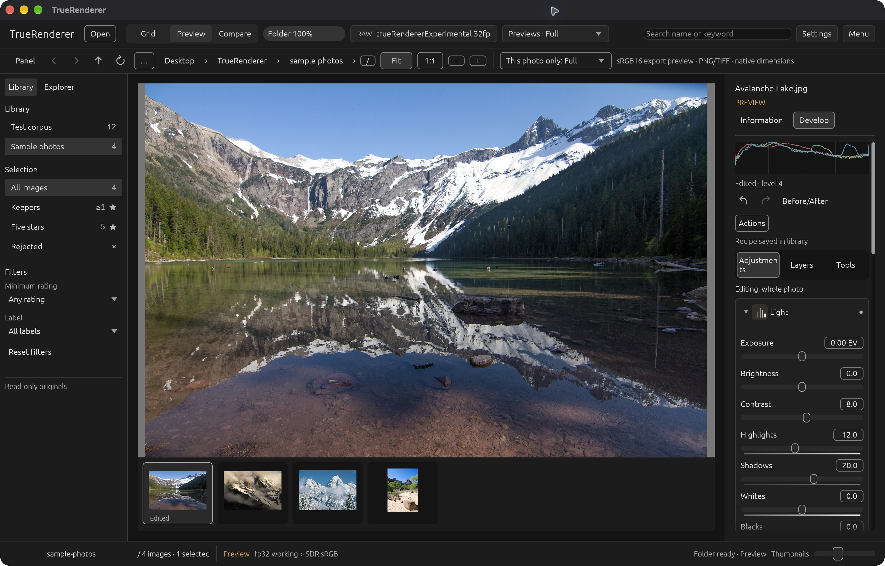
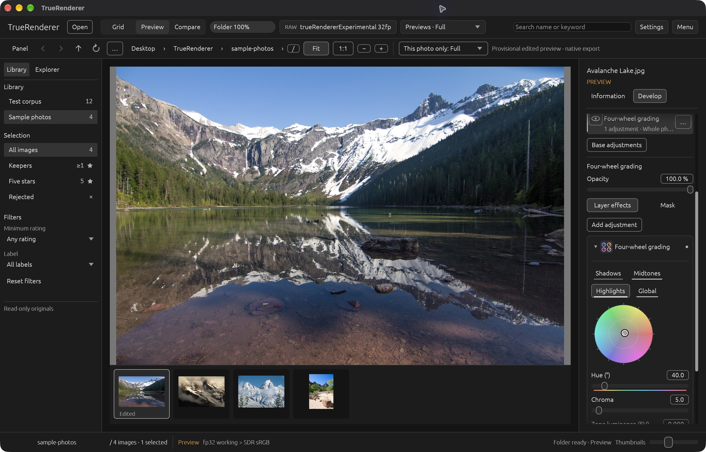
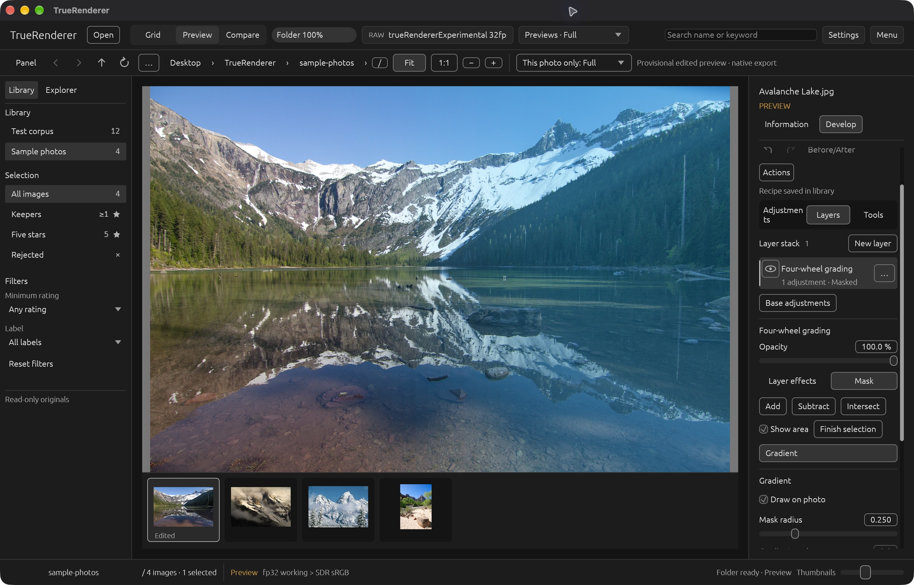
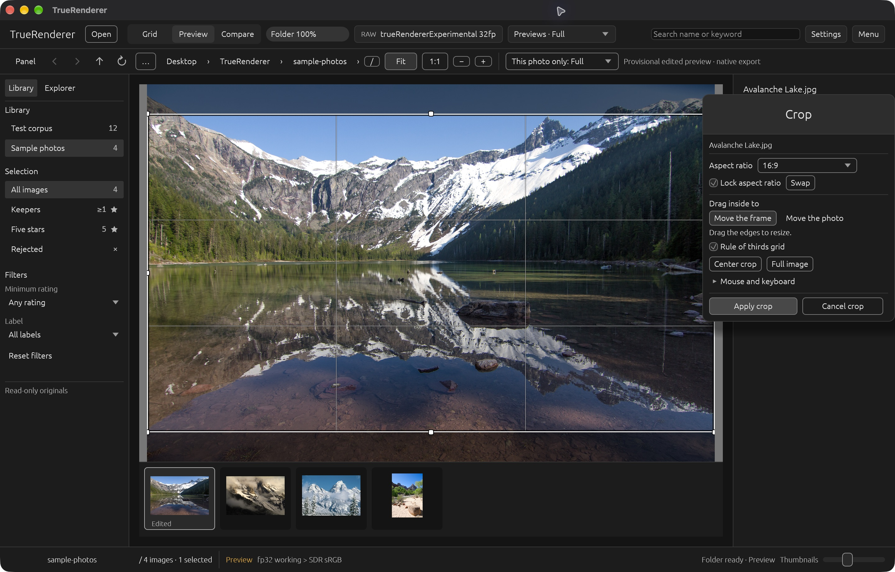
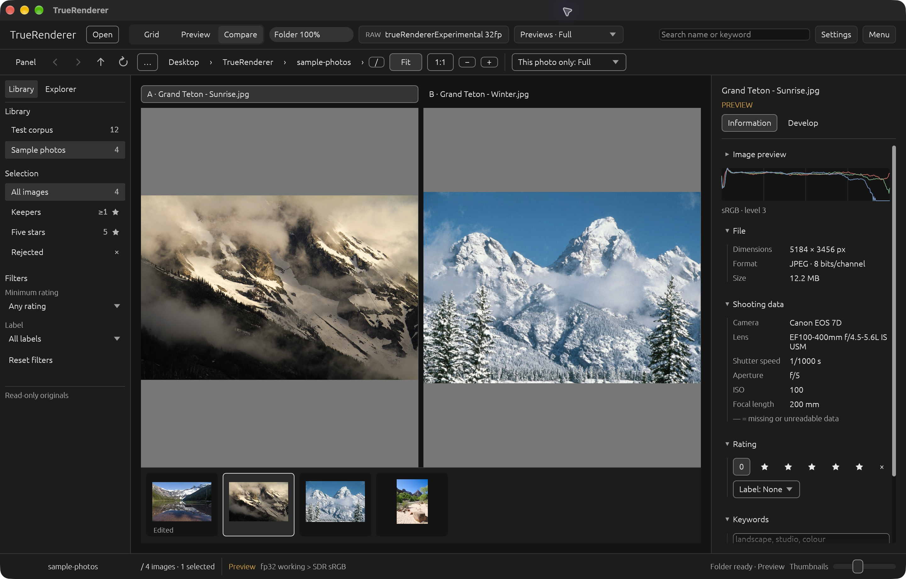
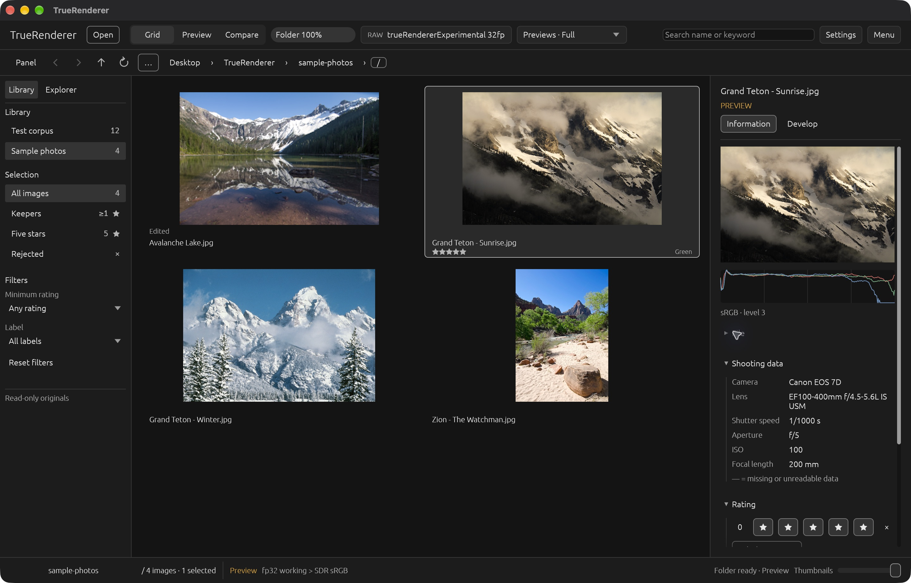

# TrueRenderer

### Your photographs. Your colour. Your way.

RAW development, expressive colour tools and photographic layers in one desktop workspace. TrueRenderer takes you from choosing your best frames to shaping the final image, with your originals untouched and your work stored locally.



Bring out the light you remember. Give a series its own colour palette. Refine one part of a photograph without changing the rest. Compare your decisions as you work, then export at the size and precision you need.

**No account, photo upload or cloud subscription is required.**

## Shape the light. Make the colour yours.

Start with the essentials: exposure, contrast, highlights, shadows and white balance. Go further with editable curves, sampled colour corrections and four-wheel grading for shadows, midtones, highlights and the whole image.

TrueRenderer works in **linear Rec.2020 floating point**, giving its photographic adjustments a wide numerical range. Histograms, tonal-level sampling and pixel inspection help you connect what you see with the image data.



| Make the image your own | Tools to get there |
|---|---|
| Balance light | Exposure, brightness, contrast, highlights, shadows, whites, blacks and automatic exposure |
| Set the white balance | RAW Temperature and Tint, As shot, automatic balance and neutral-area sampling |
| Sculpt the tones | Point curves, individual RGB curves, luminance and parametric curves; tonal levels with histograms and black, grey and white samplers |
| Refine individual colours | Saturation, vibrance, eight-band HSL, sampled colour and uniformity controls; selective colour and channel mixing |
| Create a signature palette | Four-wheel grading, colorize, colour filters, gradient maps and black-and-white mixing |
| Bring out detail | Texture, clarity, dehaze, sharpening and luminance/chroma noise reduction |
| Refine the optics | Manual distortion, vignette, chromatic aberration and defringe controls |

The searchable **Tools** catalogue puts adjustments within reach. Each tool has its own photographic symbol and visual controls; hover over a name to see what it does, in English or Italian.

## Build the look, layer by layer

Keep different creative decisions independently editable. Add an adjustment to a new photographic layer or to the selected layer, then control where it acts and how strongly it contributes.

- **A clear layer stack:** name, duplicate, reorder, hide or lock layers, with separate Opacity and Fill controls.
- **Local adjustments:** combine brush, linear and radial gradients, luminance and hue masks. Add, subtract or intersect components, soften edges and invert coverage.
- **Separate effects and masks:** switch between the selected layer's adjustments and its mask without losing your place in the stack.
- **Reusable looks:** save selected layers, preview them on another photograph, choose their intensity and optionally include their masks. Applied looks remain editable layers.



**Experiment freely.** Undo, Redo, Reset all and Before/After keep decisions reversible. Double-click a photographic slider to restore its default. Copy selected light, curve and RGB colour adjustments between photographs to carry a treatment through a series.

## Give every frame the right composition

Crop directly on the photograph with draggable edges, a rule-of-thirds grid and free, original, preset or custom aspect ratios. Lock the proportions, switch orientation, move the frame or move the photograph inside it. Keyboard controls help with fine adjustments.

Rotation, flips, straightening and perspective controls complete the composition tools. Masks follow the photograph through crop and rotation, and the original remains available for a different framing later.



## See the differences that matter

Choose between two frames with **side-by-side comparison and synchronized navigation**. Assign photographs to A and B from the context menu, keep the pair across folders, and inspect detail at physical 1:1. Use Before/After to compare the initial rendering with your current adjustments.



Shutter speed, aperture, ISO, focal length and lens information sit alongside the image, helping you understand each frame as you select and develop it.

## Find your keepers. Keep them organized.

Browse folders in **Explorer**, review a thumbnail grid in **Library**, or stay with the photograph and its filmstrip. Favourites, navigation history, search and filters help you return to the images that matter.

Use **star ratings, colour labels, reject flags and keywords** to organize a shoot. Context menus bring ratings, comparison, adjustments, file navigation and export to the photograph you are working on.



Your originals remain read-only. Editing recipes, annotations and saved looks live in the local library and its backups.

## Independent RAW development

On macOS, **trueRendererExperimental 32fp** provides an independent RAW decoding and development engine for supported Bayer/X-Trans DNGs, Nikon D750/D800 NEFs and Fujifilm X-T5 RAFs. RAW white balance offers Temperature and Tint controls, automatic balance, neutral-area sampling and an As shot reset. The engine also offers DNG export of the decoded sensor mosaic.

Compatibility depends on the camera and recording mode; see the [RAW format guide](docs/progetto-truerenderer-experimental.md) for supported combinations.

## Stay in the photographic flow

GPU acceleration for light and colour adjustments works alongside parallel CPU processing. Adaptive previews respond during slider gestures and refine after you stop. Background loading, nearby-image preparation and reusable previews help you move through a folder.

Choose **Standard or Full preview quality**, globally or for an individual photograph. Set CPU, GPU and memory preferences to suit your machine, switch between Fit and physical 1:1, and choose an English or Italian interface with 100%, 150% or 200% UI scaling.

## Finish with the output you need

Export one photograph or a selection as **JPEG, PNG or TIFF**, at native resolution or with a target long edge for delivery. PNG and TIFF offer 16-bit output; floating-point TIFF preserves extended numerical values. Check the final PNG/TIFF rendering with output verification before writing the files.

For scientific imagery, TrueRenderer also opens **2D FITS images**, with linear or asinh display, a histogram and native-value inspection.

## Try it with the included photographs

Open an image or a folder, select a photograph and choose **Develop**. Use **Adjustments** for the essentials, **Tools** to find a creative control, and **Layers** to build a local treatment. The **Actions** menu gives you looks, crop, copy/paste and output verification.

Four public-domain landscapes are included in **Library**, under **Sample photos**, including in the macOS bundle for offline use. Start there to explore the workspace. Photograph credits are included in the [sample collection](sample-photos/manifest.json).

<details>
<summary><strong>Build and run from source</strong></summary>

Run these commands from the repository root. The repository pins Rust 1.98.1; Python 3 is required by the supporting scripts.

**macOS.** Install Rust 1.98.1 and the Xcode Command Line Tools, then:

```sh
./scripts/cargo-local.sh fetch --locked
python3 scripts/generate-format-fixtures.py
./scripts/build-macos.sh
open dist/TrueRenderer.app --args --open "/path/to/photos"
```

Use the macOS app bundle for external photographs: it includes the isolated decoder services.

**Windows.** Install Rust 1.98.1 with rustfmt and Clippy, Visual Studio Build Tools with the Desktop development with C++ workload and Windows SDK, Python 3, and Git for Windows. In PowerShell:

```powershell
.\scripts\dev-windows.ps1 fetch --locked
.\scripts\dev-windows.ps1 verify --gui
.\target\debug\truerenderer.exe
```

The [documentation index](docs/README.md) covers platform-specific formats, architecture and configuration.

Keep `var/library.sqlite` and `var/backups/`: they contain durable library data. To remove compilation artifacts, use `./scripts/cargo-local.sh clean`.

</details>

TrueRenderer is proprietary software. See the [license](LICENSE) and [third-party notices](NOTICE.md).

Screenshots show the native macOS app in English, using public-domain photographs by the National Park Service, including NPS / David Restivo. See the [photograph credits](sample-photos/manifest.json) and [screenshot provenance](reports/readme-showcase-macos-2026-10-20.json).
