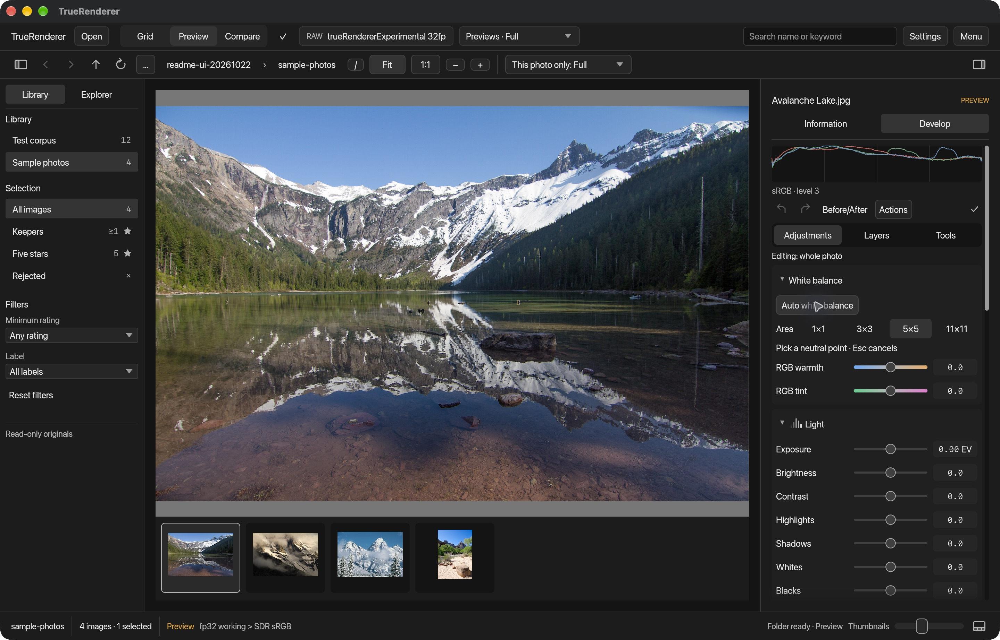
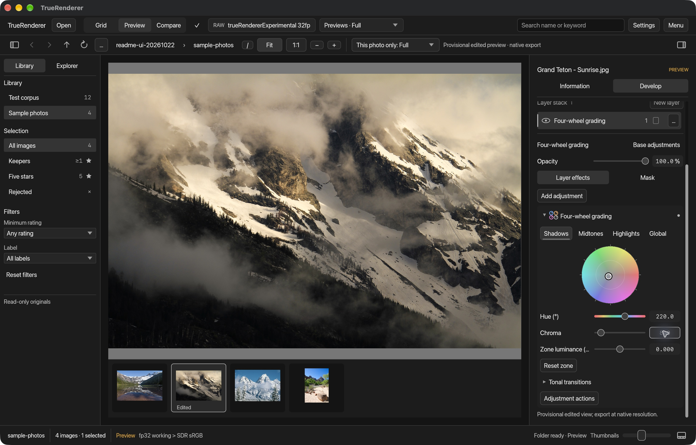
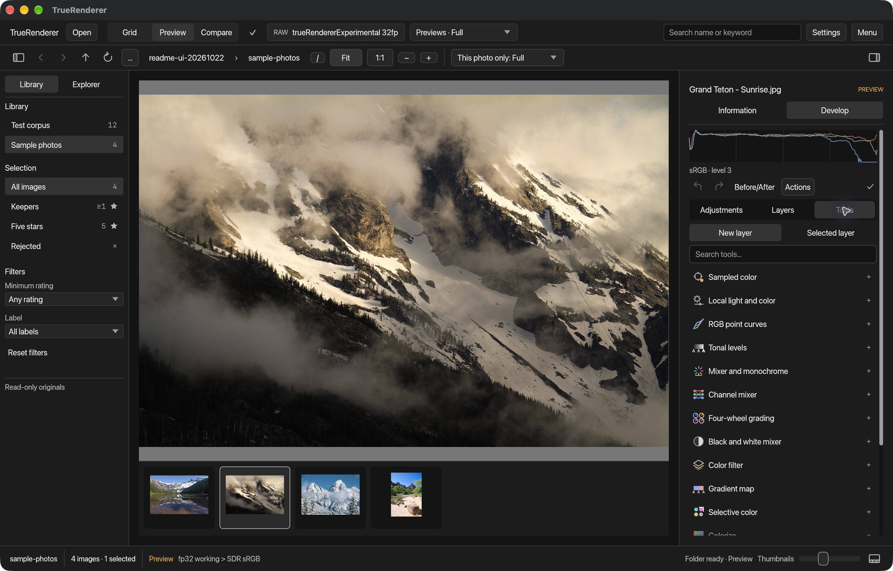
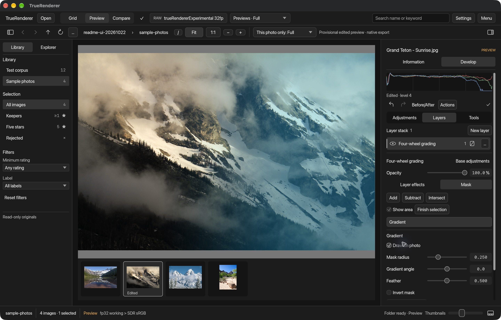
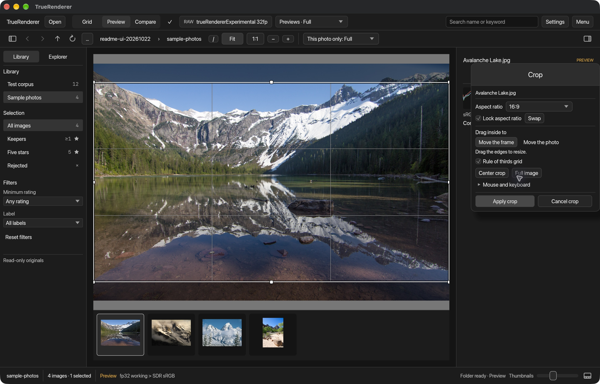
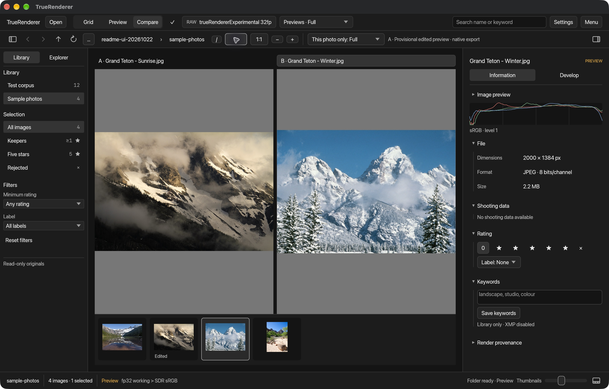
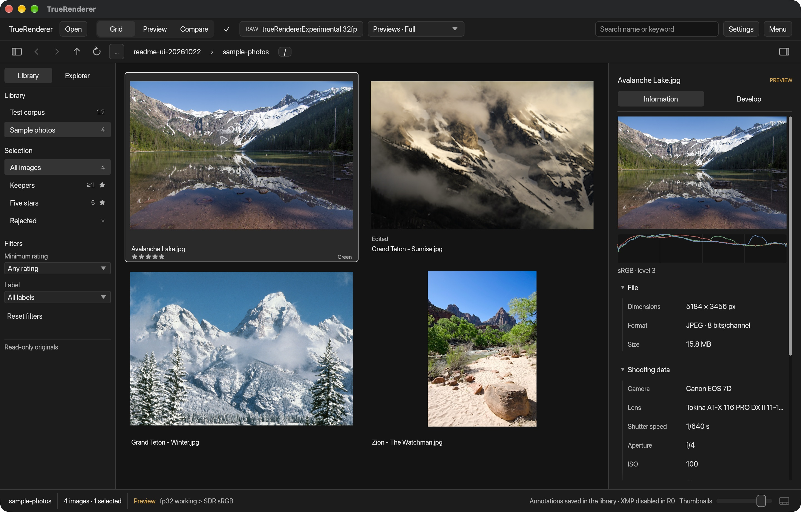
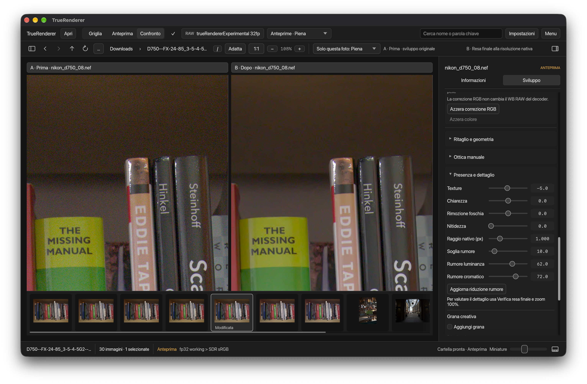

# TrueRenderer

### Your photographs. Your colour. Your way.

RAW development, expressive colour tools and photographic layers in one desktop workspace. TrueRenderer takes you from choosing your best frames to shaping the final image, with your originals untouched and your work stored locally.



Bring out the light you remember. Give a series its own colour palette. Refine one part of a photograph without changing the rest. Compare your decisions as you work, then export at the size and precision you need.

**No account, photo upload or cloud subscription is required.**

## Shape the light. Make the colour yours.

Start with the essentials: exposure, contrast, highlights, shadows and white balance. Go further with editable curves, sampled colour corrections and four-wheel grading for shadows, midtones, highlights and the whole image.

In Develop, click **Auto white balance**, choose a **1×1, 3×3, 5×5 or 11×11** sample area, then click an unclipped white or neutral grey region in the photo. The correction applies automatically and can be undone; **Esc** cancels the eyedropper. The default area is 5×5 original pixels.

TrueRenderer works in **linear Rec.2020 floating point**, giving its photographic adjustments a wide numerical range. Histograms, tonal-level sampling and pixel inspection help you connect what you see with the image data.



| Make the image your own | Tools to get there |
|---|---|
| Balance light | Exposure, brightness, contrast, highlights, shadows, whites, blacks and automatic exposure |
| Set the white balance | RAW Temperature and Tint, As shot, automatic balance and neutral-area sampling |
| Sculpt the tones | Point curves, individual RGB curves, luminance and parametric curves; tonal levels with histograms and black, grey and white samplers |
| Refine individual colours | Saturation, vibrance, eight-band HSL, sampled colour and uniformity controls; selective colour and channel mixing |
| Create a signature palette | Four-wheel grading, colorize, colour filters, gradient maps and black-and-white mixing |
| Bring out detail | Texture, clarity, dehaze, sharpening and luminance/chroma noise reduction |
| Refine the optics | Manual distortion, vignette, chromatic aberration and defringe controls |

The searchable **Tools** catalogue puts adjustments within reach. Each tool has its own photographic symbol and visual controls; hover over a name to see what it does, in English or Italian.

For a vintage texture, use **Creative grain** in **Presence and detail**. Enable **Add grain**, choose **Uniform** or **Gaussian**, then adjust **Grain amount**, **Grain size (px)** and **Grain opacity**. **Monochrome grain** adds neutral grain; turn it off for coloured speckles. **New pattern** changes the arrangement, which is saved with the edit. Disabling the effect keeps its settings. Judge fine grain at 100% with **Verify final rendering**; smaller exports naturally soften it.



## Build the look, layer by layer

Keep different creative decisions independently editable. Add an adjustment to a new photographic layer or to the selected layer, then control where it acts and how strongly it contributes.

- **A clear layer stack:** name, duplicate, reorder, hide or lock layers, with separate Opacity and Fill controls.
- **Local adjustments:** combine brush, linear and radial gradients, luminance and hue masks. Add, subtract or intersect components, soften edges and invert coverage.
- **Separate effects and masks:** switch between the selected layer's adjustments and its mask without losing your place in the stack.
- **Reusable looks:** save selected layers, preview them on another photograph, choose their intensity and optionally include their masks. Applied looks remain editable layers.



**Experiment freely.** Undo, Redo, Reset all and Before/After keep decisions reversible. Double-click a photographic slider to restore its default. Copy selected light, curve and RGB colour adjustments between photographs to carry a treatment through a series.

Colour guides appear directly in the slider tracks. The path bar has matching icons to show or hide the left and right panels. The filmstrip toggle is at the right of the bottom status bar. Keyboard shortcuts remain **Cmd/Ctrl+B** for the left panel, **I** for Develop / Information and **T** for the viewer filmstrip.

Choose the RAW engine in **Settings → Previews and RAW**, then **Apply and save**. The top bar shows the applied default; **Photo:** identifies a different engine stored in the selected RAW photo’s recipe. Changing the default preserves existing edits and compatible previews, including decoded JPEGs in the current session.

Exposure and tone-curve previews preserve the detail available in the viewer, including at 100%. Later clicks on the interface do not restart a reduced editing preview. Spatial filters and active layers still use provisional previews during adjustments.

While you pause on a photograph in Fit, TrueRenderer prepares its detail and applied adjustments in the background for the first zoom. Preview quality stays unchanged. Immediate zooming, recent edits or limited memory can still require refinement.

## Give every frame the right composition

Crop directly on the photograph with draggable edges, a rule-of-thirds grid and free, original, preset or custom aspect ratios. Lock the proportions, switch orientation, move the frame or move the photograph inside it. Keyboard controls help with fine adjustments.

Rotation, flips, straightening and perspective controls complete the composition tools. Masks follow the photograph through crop and rotation, and the original remains available for a different framing later.



## See the differences that matter

Choose between two frames with **side-by-side comparison and synchronized navigation**. Assign photographs to A and B from the context menu, keep the pair across folders, and inspect detail at physical 1:1. Use Before/After to compare the initial rendering with your current adjustments.



Shutter speed, aperture, ISO, focal length and lens information sit alongside the image, helping you understand each frame as you select and develop it.

## Find your keepers. Keep them organized.

Browse folders in **Explorer**, review a thumbnail grid in **Library**, or stay with the photograph and its filmstrip. Favourites, navigation history, search and filters help you return to the images that matter.

Use **star ratings, colour labels, reject flags and keywords** to organize a shoot. Context menus bring ratings, comparison, adjustments, file navigation and export to the photograph you are working on.



Your originals remain read-only. Editing recipes, annotations and saved looks live in the local library and its backups.

## Choose your RAW rendering engine

Choose a rendering engine in Settings to explore different interpretations of your RAW files:

- **TrueRenderer**: our flagship independent RAW engine, available on macOS as **trueRendererExperimental 32fp**. Its 32-bit floating-point pipeline preserves negative values and values above nominal white, offering greater numerical headroom than the app's 16-bit integer LibRaw paths. Independent decoding, directional reconstruction and sensor-aware highlight treatment give it a dedicated path from the sensor mosaic to the developed image.
- **Apple RAW**: native macOS RAW development through Apple's camera support and rendering pipeline. Camera compatibility follows the decoder installed with macOS.
- **LibRaw AHD**: LibRaw decoding with Adaptive Homogeneity-Directed demosaicing, providing an alternative rendering for comparison.
- **LibRaw bilinear**: LibRaw decoding with bilinear interpolation, a straightforward rendering option for comparison.

TrueRenderer includes Temperature and Tint controls, neutral-area white-balance sampling, an As shot reset and DNG export of the decoded sensor mosaic. Its fp32 headroom is a concrete advantage; the best-looking rendering still depends on the photograph and the adjustments you choose.

### Camera compatibility

The following camera models and recording modes are currently supported by **TrueRenderer's independent engine**:

| Camera | RAW format | Supported recording modes |
|---|---|---|
| **Nikon D750** | NEF · Bayer | Full-frame FX, 14-bit lossless compressed RAW |
| **Nikon D800** | NEF · Bayer | Full-frame FX, 12-bit or 14-bit lossless compressed RAW |
| **Fujifilm X-T5** | RAF · X-Trans | Full-resolution, 14-bit lossy compressed RAW |

Supported Bayer and X-Trans **DNG files** can also use the independent engine. Compatibility depends on the file's compression and calibration features. Apple RAW and LibRaw have their own camera coverage.

**Camera compatibility is expanding week by week.** I am continually adding support for new models and recording modes. If you need a particular camera implemented, contact me with the manufacturer, exact model, RAW format, bit depth and compression settings, plus an original RAW sample if available. Your requests help shape the next additions.

## Stay in the photographic flow

GPU acceleration for light and colour adjustments works alongside parallel CPU processing. Adaptive previews respond during slider gestures and refine after you stop. Folder loading prepares detail, saved adjustments and thumbnails together, and reuses completed results from the disk cache. Choose foreground loading to finish preparation before browsing, or keep working while it runs in the background. Editing gestures take priority over background preparation. Cache and memory limits still apply.

Choose **Standard or Full preview quality**, globally or for an individual photograph. Set CPU, GPU and memory preferences to suit your machine, switch between Fit and physical 1:1, and choose an English or Italian interface with 100%, 150% or 200% UI scaling.

## Finish with the output you need

Export one photograph or a selection as **JPEG, PNG or TIFF**, at native resolution or with a target long edge for delivery. PNG and TIFF offer 16-bit output; floating-point TIFF preserves extended numerical values. Check the final PNG/TIFF rendering with output verification before writing the files.

For scientific imagery, TrueRenderer also opens **2D FITS images**, with linear or asinh display, a histogram and native-value inspection.

## Try it with the included photographs

Open an image or a folder, select a photograph and choose **Develop**. Use **Adjustments** for the essentials, **Tools** to find a creative control, and **Layers** to build a local treatment. The **Actions** menu gives you looks, crop, copy/paste and output verification.

Four public-domain landscapes are included in **Library**, under **Sample photos**, including in the macOS bundle for offline use. Start there to explore the workspace. Photograph credits are included in the [sample collection](sample-photos/manifest.json).

<details>
<summary><strong>Build and run from source</strong></summary>

Run these commands from the repository root. The repository pins Rust 1.98.1; Python 3 is required by the supporting scripts.

**macOS.** Install Rust 1.98.1 and the Xcode Command Line Tools, then:

```sh
./scripts/cargo-local.sh fetch --locked
python3 scripts/generate-format-fixtures.py
./scripts/build-macos.sh
open dist/TrueRenderer.app --args --open "/path/to/photos"
```

Use the macOS app bundle for external photographs: it includes the isolated decoder services.

**Windows.** Install Rust 1.98.1 with rustfmt and Clippy, Visual Studio Build Tools with the Desktop development with C++ workload and Windows SDK, Python 3, and Git for Windows. In PowerShell:

```powershell
.\scripts\dev-windows.ps1 fetch --locked
.\scripts\dev-windows.ps1 verify --gui
.\target\debug\truerenderer.exe
```

Alternatively, Rust's `x86_64-pc-windows-gnu` toolchain can use MinGW-w64/GCC
with POSIX threads instead of Visual Studio. Add its `bin` directory to the build
process's PATH. The worker links libstdc++ and winpthread statically so its LPAC
copy does not need compiler runtime DLLs.

**Windows with Smart App Control enabled.** Locally compiled executables may be
blocked, including Cargo build scripts before the application is produced. Changing
the compiler or using a self-signed certificate does not establish public trust.
Build in an authorized development environment and sign the resulting application
and worker with a certificate from a provider accepted by Smart App Control.
SignTool is available separately in the Windows SDK; signing does not require
Visual Studio.

For a prebuilt staging directory containing `truerenderer.exe`, `tr-worker.exe`
and its runtime DLLs, `scripts/sign-windows.ps1` signs every EXE/DLL recursively
using a code-signing certificate in `CurrentUser\My` (including supported hardware
or cloud providers). Supply the provider's HTTPS RFC 3161 timestamp endpoint:

```powershell
.\scripts\sign-windows.ps1 -BinaryDirectory .\dist\TrueRenderer-windows -CertificateThumbprint YOUR_CERTIFICATE_THUMBPRINT -TimestampUrl https://YOUR_PROVIDER_TIMESTAMP_ENDPOINT -SignTool C:\path\to\signtool.exe
.\scripts\sign-windows.ps1 -BinaryDirectory .\dist\TrueRenderer-windows -VerifyOnly
```

The verifier requires embedded, timestamped Authenticode signatures on both
executables and every DLL. It checks this computer's trust store; it cannot certify
that a locally trusted CA belongs to Microsoft's public trust program. A native
test of the app **and decoder** with Smart App Control enabled remains necessary.
This script neither builds nor packages the application and does not fix blocked
intermediate build tools. Keep the original build separately: signing modifies
the staged binaries. Provider enrollment, public trust and native validation are
prerequisites, not guarantees supplied by the script.
See [Microsoft's signing requirements](https://learn.microsoft.com/en-us/windows/apps/develop/smart-app-control/code-signing-for-smart-app-control).

The [documentation index](docs/README.md) covers platform-specific formats, architecture and configuration.

Keep `var/library.sqlite` and `var/backups/`: they contain durable library data. To remove compilation artifacts, use `./scripts/cargo-local.sh clean`.

</details>

TrueRenderer is proprietary software. See the [license](LICENSE) and [third-party notices](NOTICE.md).

Screenshots show the native macOS app in English, with the denoising example in Italian. Landscapes are public-domain photographs by the National Park Service, including NPS / David Restivo; the denoising example uses a Nikon D750 ISO 12800 RAW from the existing test corpus (original photographic rights retained). See the [landscape credits](sample-photos/manifest.json) and [screenshot provenance and RAW source](reports/readme-ui-showcase-macos-2026-10-22.json).

## Reduce noise. Keep the detail.

For noisy RAW or JPEG photographs, open **Presence and detail** and adjust **Luminance noise** and **Chroma noise** independently. The filter adapts to image brightness and treats both fine colour speckles and larger blotches while protecting stronger edges. **Noise threshold** increases its sensitivity: zero keeps the automatic estimate, and higher values remove more weak variations. The threshold also protects against grain enhancement by Texture, Clarity and Sharpening. Start with moderate amounts and threshold zero, then judge at 100% with **Verify final rendering**; high amounts or thresholds can soften weak detail. Older edits keep their original rendering until you change one of these three controls or choose **Update noise reduction**; Undo restores the previous revision.



**Before/After at 105%:** a real ISO 12800 RAW from a Nikon D750, with Luminance noise 62, Chroma noise 72, Noise threshold 10, Texture 33 and Sharpening 30 (radius 1.3 px). The right-hand image shows the final rendering at native resolution; creative grain is off.
