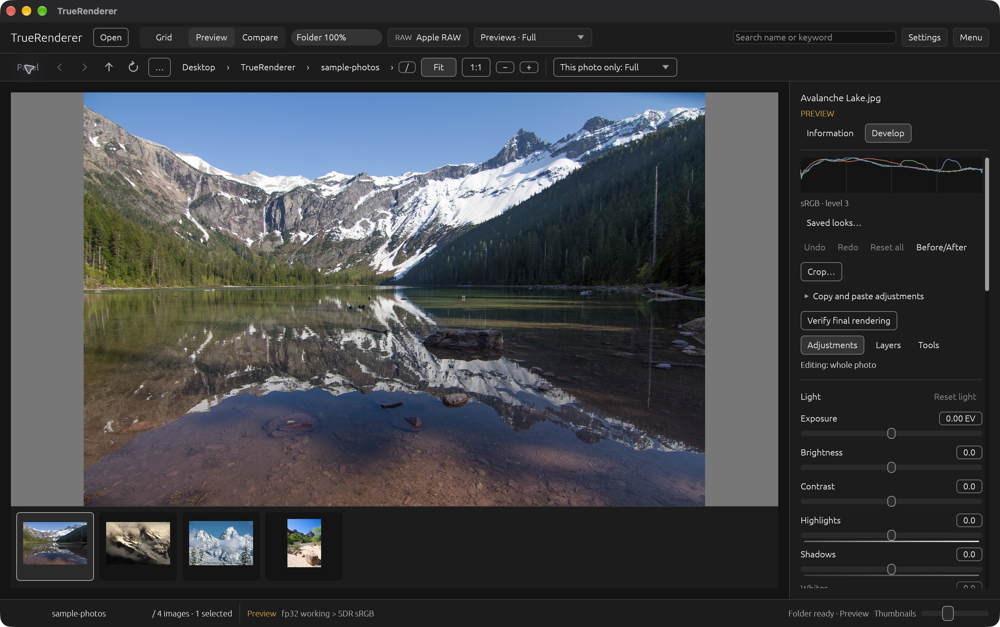
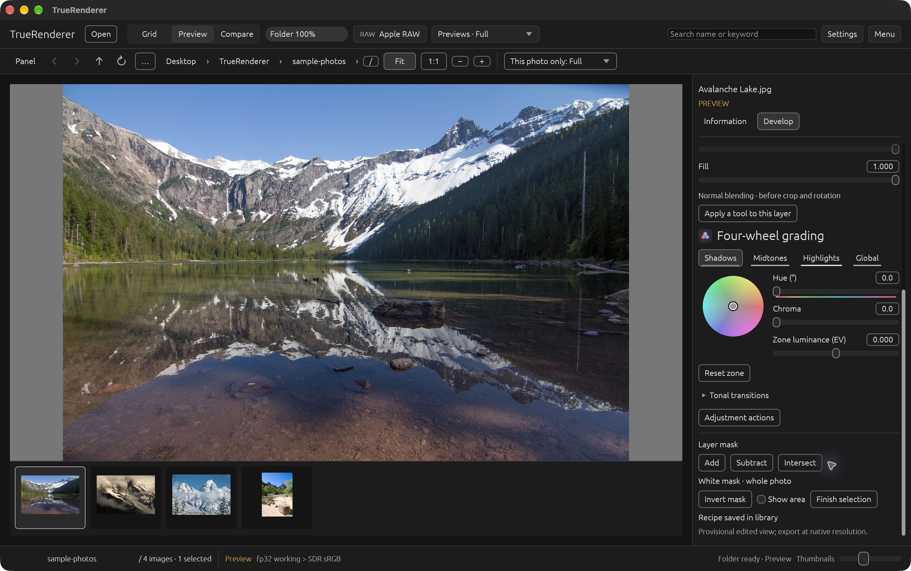
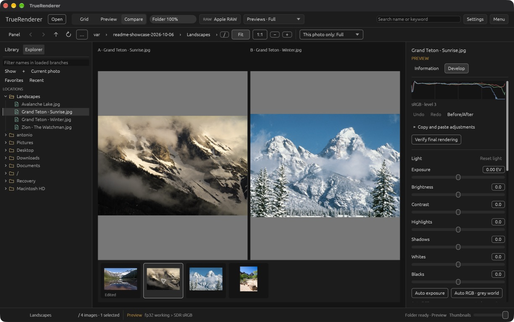
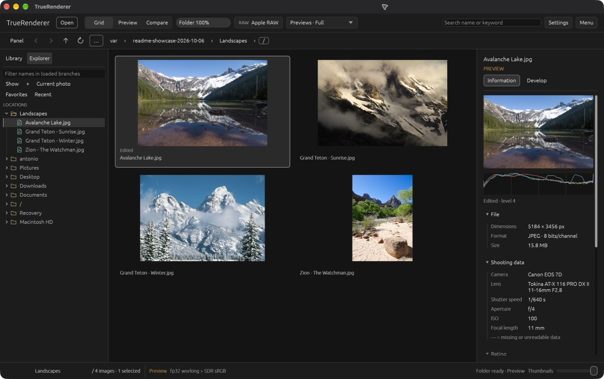

# TrueRenderer

### Your photographs. Your vision. Every detail under your control.

TrueRenderer brings powerful RAW development, expressive colour tools and fast photographic browsing into one native desktop workspace. Select your best frames, shape light and colour, compare every decision and export the finished image, with your originals untouched and your work stored locally.

Our ambition is simple: **exceptional colour fidelity, precise image processing and performance that keeps pace with the photographer.** TrueRenderer combines a floating-point foundation with direct creative controls, putting both the technical detail and the final look in your hands.



GPU acceleration, independent RAW development, photographic layers and masks, reversible editing and a local library.

## Power that keeps you in the creative flow

GPU acceleration for light and colour adjustments works alongside parallel CPU processing. Adaptive previews follow slider gestures and refine after you stop; background loading, nearby-image preloading and reusable previews help you move through a shoot.

Choose **Standard or Full preview quality**, globally or for an individual photograph. Tune CPU, GPU and memory preferences to your machine, switch between Fit and physical 1:1, and keep the filmstrip close while you work.

## Colour deserves precision

TrueRenderer's **linear Rec.2020 floating-point working space** gives tonal and colour operations a wide numerical range. RAW white balance, editable curves, histograms and pixel inspection connect creative decisions to the image data. Native-resolution export applies the saved photographic recipe to the source.

Start with a natural rendering or develop a distinctive style. Refine a sampled colour, balance individual tonal zones, build a monochrome treatment or combine adjustments in a reusable look.



| Creative control | Tools at your fingertips |
|---|---|
| Light and contrast | Exposure, brightness, contrast, highlights, shadows, whites and blacks; automatic exposure |
| Tone shaping | Editable point curves, individual RGB curves, luminance and parametric curves; tonal levels with histograms and black/gray/white sampling |
| White balance | As-shot, manual, automatic and neutral-area sampling for supported RAW files |
| Colour refinement | Warmth, tint, saturation, vibrance, warm-tone protection, eight-band HSL and channel mixers |
| Creative colour | Four-wheel grading, selective colour, colorize, colour filters, gradient maps and black-and-white mixing |
| Targeted adjustments | Sampled hue/chroma/luminance corrections and separate uniformity controls |
| Detail and atmosphere | Texture, clarity, dehaze, sharpening and luminance/chroma noise reduction |
| Composition | Interactive crop, aspect ratios, rotation, flips, straightening and perspective controls |
| Optical adjustments | Manual distortion, vignette, chromatic aberration and defringe controls |

## Build the look, layer by layer

The searchable **Tools** catalogue lets you apply an adjustment to a new photographic layer or the selected layer. Name, duplicate, reorder and hide layers; refine their contribution with separate **Opacity** and **Fill** controls.

Combine brush, radial and linear gradients, luminance and hue masks. Add, subtract or intersect selections, feather their edges and invert their coverage. Masks follow the photograph through crop and rotation.


**Saved looks** turn selected layers into reusable treatments. Preview a look on another photograph, choose its intensity and whether to include masks, then apply it as independently editable layers.

**Undo, Redo, Reset all and Before/After** keep experimentation reversible. Editing recipes, looks and annotations stay in your local library and its backups. Double-click a photographic slider to restore its default; copy selected light, curve and RGB colour adjustments between photographs for a consistent series.

## Independent RAW development

On macOS, **trueRendererExperimental 32fp** provides an independent RAW decoding and development path. It reads supported Bayer/X-Trans DNGs, Nikon D750 FX lossless 14-bit NEFs, D800 FX lossless 12/14-bit NEFs and Fujifilm X-T5 lossy 14-bit RAFs. It uses its own X-Trans reconstruction and offers automatic and sampled white balance with precise sensor gains, plus DNG export of the decoded mosaic. See the [RAW format and engine guide](docs/progetto-truerenderer-experimental.md) for exact camera modes and technical details; codec and data attribution are in [NOTICE](NOTICE.md).

## See the differences that matter

Compare photographs side by side with synchronized navigation, or compare the initial rendering with your current adjustments. Assign photographs to **A** and **B** from the context menu, keep the pair across folders, and inspect fine detail at physical 1:1.



Histograms, a pixel sampler and shooting metadata sit alongside the image. Shutter speed, aperture, ISO, focal length and lens information help you understand each frame as you select and refine it.

## Bring order to your photographs

Browse folders with **Explorer**, manage your selection in **Library**, scan a thumbnail grid or stay immersed in the viewer. Favourites, navigation history, search and filters bring useful photographs within reach.



Use **star ratings, colour labels, reject flags and keywords** to organize a shoot. Context menus bring ratings, geometry, comparison, export and file navigation to the photograph you are working on.

**Your originals remain read-only. Your library stays on your computer. No account, photo upload or cloud subscription is required.**

## Finish with the output you need

Export individual photographs or a selection as **JPEG, PNG or TIFF**, with 8-bit or 16-bit options where supported and floating-point TIFF for extended numerical values. Set a target long edge for delivery and inspect the final PNG/TIFF rendering before writing the files.

For scientific imagery, TrueRenderer also opens **2D FITS images**, with linear or asinh display, a histogram and native-value inspection.

## Make it your workspace

Open an image or a folder, choose a photograph and switch to **Develop**. Open **Settings**, then **Previews and RAW**, to choose preview quality and configure RAW development. English and Italian interfaces, 100%/150%/200% UI scaling and adjustable panels help the workspace fit your screen.

Try the four public-domain landscapes in **Library**, under **Sample photos**. Their originals and credits are included in [`sample-photos/`](sample-photos/manifest.json); the macOS bundle includes them for offline use.

<details>
<summary><strong>Build and run from source</strong></summary>

Run these commands from the repository root. The repository pins Rust 1.98.1; Python 3 is required by the supporting scripts.

**macOS.** Install Rust 1.98.1 and the Xcode Command Line Tools, then:

```sh
./scripts/cargo-local.sh fetch --locked
python3 scripts/generate-format-fixtures.py
./scripts/build-macos.sh
open dist/TrueRenderer.app --args --open "/path/to/photos"
```

Use the macOS app bundle for external photographs: it includes the isolated decoder services.

**Windows.** Install Rust 1.98.1 with rustfmt and Clippy, Visual Studio Build Tools with the Desktop development with C++ workload and Windows SDK, Python 3, and Git for Windows. In PowerShell:

```powershell
.\scripts\dev-windows.ps1 fetch --locked
.\scripts\dev-windows.ps1 verify --gui
.\target\debug\truerenderer.exe
```

The [documentation index](docs/README.md) covers platform-specific formats, architecture and configuration. Camera and file compatibility depend on the supported format, camera mode and platform.

Keep `var/library.sqlite` and `var/backups/`: they contain durable library data. To remove compilation artifacts, use `./scripts/cargo-local.sh clean`.

</details>

TrueRenderer is proprietary software. See the [license](LICENSE) and [third-party notices](NOTICE.md).

Screenshots show the native English interface. Landscape photographs: National Park Service, including NPS / David Restivo; public-domain source credits and capture details: [photographs and comparison/library views](reports/readme-showcase-macos-2026-10-06.json), [development, tools and grading views](reports/readme-showcase-macos-2026-10-11.json).
