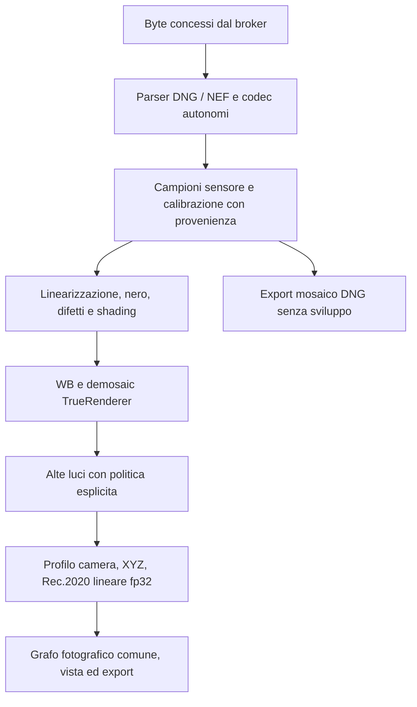

# trueRendererExperimental — motore RAW autonomo e fedeltà cromatica

Specifica di progetto del 9 ottobre 2026, derivata dalla richiesta del titolare: costruire un motore aggiuntivo sulla base di TrueRenderer, sostituendo le responsabilità oggi affidate a LibRaw e perseguendo la massima fedeltà cromatica misurabile. Ordine richiesto: **DNG prima, poi Nikon D750, Fujifilm X-T5, Nikon D800 e D850**. Il piano operativo, le prove eseguite e le caselle di avanzamento risiedono esclusivamente in [STATO.md](../STATO.md#truerendererexperimental--piano-e-sviluppo-del-9-ottobre).

Il documento distingue l'analisi del codice di partenza dai requisiti del nuovo motore. «Autonomo», «decodifica corretta» e «colore qualificato» hanno verifiche separate; il nome del motore non certifica nessuna delle tre proprietà.

## 1. Decisione di progetto e obiettivo

### ADR 0012 — sostituzione di LibRaw nel percorso Experimental

La richiesta autorizza un percorso sperimentale distinto dalla baseline di [§7 dell'architettura](TrueRenderer-Architettura.md#7-pipeline-raw). È una deroga circoscritta al rinvio della ricerca RAW post-v1: non modifica le condizioni di promozione, i gate R/SF o la promessa degli altri motori.

Si progetta un nucleo Rust con responsabilità separate: contenitore/codec, segnale del sensore, ricostruzione RGB, caratterizzazione della fotocamera. Il nucleo riusa i contratti numerici e applicativi di TrueRenderer, con un proprio ingresso RAW. Non deve dipendere da LibRaw per riconoscere, aprire, sviluppare o esportare i formati che dichiara supportati.

Le decisioni sono:

1. Conservare `RawEngine::TrueRenderer`, la sua identità serializzata e la ricetta `LibRaw-0.22.2-TR-directional-f32-sensor-highlights-v2`. La nuova variante proposta è `RawEngine::TrueRendererExperimental`, con etichetta visibile **trueRendererExperimental 32fp**. Nessun cambio dei default di piattaforma.
2. Realizzare prima DNG Bayer con contratto delimitato, poi NEF D750/D800/D850 e RAF Fujifilm X-T5 per sottotipo provato. L'autonomia non richiede di riprodurre subito l'intero catalogo di LibRaw.
3. Scrivere il percorso iniziale di parsing/decodifica in Rust, riutilizzando dipendenze generiche ammissibili dove corrette. Un codec esterno non è escluso per principio; nessun altro sviluppatore RAW diventa un requisito nascosto.
4. Conservare Rec.2020 lineare esteso fp32, alpha uno per RAW opachi, negativi e valori sopra uno, orientamento applicato una volta, grafo di sviluppo ed export comuni.
5. Usare il demosaic direzionale esistente come punto di partenza e controllo. Valutare RI/MLRI e poi ARI; adottare un metodo più complesso soltanto dopo prove sul segnale lineare, sul rumore e sui colori difficili.
6. Dare priorità a calibrazione del sensore e profili colore verificabili. Denoise, ricostruzione delle alte luci e look sono decisioni esplicite e versionate, non mezzi per migliorare artificialmente il punteggio del renderer.

Il requisito successivo di implementazione propria e miglioramento misurabile è definito nel [§14](#14-implementazione-propria-e-miglioramento-misurabile). Restringe la scelta del codec Fuji per il candidato successivo: il port CDDL resta una baseline dichiarata, non soddisfa da solo l'obiettivo di origine propria del codice. L'indipendenza delle routine, quella dei dati di calibrazione e la qualità fotografica hanno verifiche distinte.

L'app completa può continuare a contenere LibRaw per i motori precedenti. L'autonomia di Experimental richiede invece **zero chiamate LibRaw nel suo percorso** e un eseguibile di verifica del nucleo compilabile senza LibRaw. La rimozione della libreria dall'intero prodotto sarebbe una migrazione ulteriore, incompatibile con il mantenimento inalterato delle scelte storiche.

### Che cosa significa massima fedeltà

L'obiettivo è minimizzare l'errore rispetto a riferimenti della scena misurati, nelle condizioni e nel dominio dichiarati, preservando quanto il sensore ha registrato. Comprende accuratezza dei colori, neutralità, stabilità con esposizione/illuminante, falsi colori sui dettagli e incertezza delle zone sature.

Una fotocamera RGB non consente in generale di ricostruire univocamente lo spettro della scena. Risposte spettrali, illuminazione e metamerismo pongono limiti anche a un software perfetto; una matrice o una LUT non li elimina universalmente. La letteratura sulla [caratterizzazione colorimetrica delle fotocamere](https://pmc.ncbi.nlm.nih.gov/articles/PMC4299059/) motiva il limite e l'uso di obiettivi percettivi. Qui si propone quindi una fedeltà **misurata per condizioni**, senza una promessa di ΔE zero su qualunque soggetto.

## 2. Analisi delle responsabilità attuali

L'analisi riguarda il codice locale, non una descrizione generica delle capacità di LibRaw. Le API esterne sono riscontrabili nella [documentazione LibRaw](https://www.libraw.org/docs/API-CXX.html), ma l'insieme realmente chiamato è molto più circoscritto.

| Responsabilità | Percorso di partenza | Sostituzione richiesta per Experimental |
|---|---|---|
| Riconoscere RAW e distinguerli dai bitmap | `EngineDecoder::is_raw` chiama il probe LibRaw bilineare; segue il controllo del contenitore e, su Mac, il probe nativo | Classificatore autonomo con esiti bitmap certo, RAW supportato, RAW non supportato, corrotto/ambiguo. Il rifiuto di un RAW non autorizza Apple RAW o JPEG |
| Aprire il contenitore e identificare il modello | `open_and_identify` → `open_buffer` | TIFF/IFD e DNG propri; poi NEF/MakerNotes. Byte concessi dal broker, nessuna riapertura per percorso |
| Estrarre e decomprimere il sensore | `tr_mosaic_read` → `unpack` | Codec per ciascun sottotipo ammesso, con limiti prima dell'allocazione e controlli dei bitstream |
| Interpretare le curve del formato | Anche all'interno dei decoder LibRaw; il decoder Nikon applica una curva durante l'unpack | Dichiarare dominio dei codici e linearizzazione già applicata; non applicare due volte la curva e non confondere decompressione con recupero di informazione perduta |
| Area utile, margini e CFA | `raw2image`, `sizes`, `COLOR` | Geometria esplicita del piano completo, origine CFA, area attiva e crop di presentazione distinti |
| Livelli del sensore | `black`, `cblack`, `maximum`, riletti dopo unpack | Metadati originali e calibrazione per modalità; nero spaziale e soglie di saturazione rappresentabili senza ridurli sempre a quattro numeri |
| WB come scattato | `cam_mul`, normalizzato rispetto al verde | Lettura del neutro/WB dal formato, provenienza e validazione; nessun daylight o gray-world implicito |
| Trasformata colore | `rgb_cam` consegnata come camera → sRGB lineare | Profilo proprio o incorporato, con illuminante, dominio d'ingresso e trasformata espliciti |
| Matrice per DNG RAW in uscita | `tr_mosaic_color_matrix` usa `cam_xyz`, oppure la prima `ColorMatrix` DNG se D65 | Esportare calibrazione originale rappresentabile o profilo autorizzato, senza dipendere dalla tabella LibRaw |
| Normalizzazione e WB applicato ai campioni | Già Rust, in `mosaic::develop_with_wb` | Riutilizzare il principio, estendere i contratti del sensore; non copiare assunzioni valide soltanto per i modelli storici |
| Demosaic | Già Rust, in `demosaic.rs` | Baseline derivata dal metodo esistente, poi candidati separati e versionati |
| Alte luci, passaggio in Rec.2020, orientamento | Già Rust, in `demosaic.rs` | Stadi espliciti con politiche proprie; mantenere invariato il percorso storico |
| WB Auto/contagocce | `raw_wb::estimate` misura render e richiama il decoder fino a 16 volte | Metodo Experimental sul segnale camera calibrato, con rumore e saturazione identificati prima della matrice; vecchio stimatore conservato per le vecchie ricette |
| Export del mosaico DNG | `export::raw` chiama direttamente `mosaic::export_mosaic`, senza argomento motore | Instradamento esplicito del backend di estrazione anche per questa operazione |
| Versioni e costruzione | Tre ricette con prefisso LibRaw; `tr-worker/build.rs` compila la libreria su Mac/Windows | Dipendenza del nuovo nucleo separata; build di prova senza backend storici e integrazione normale con entrambi |

Riferimenti locali: [bridge C++](../native/libraw/tr_libraw.cpp), [contratto C](../native/libraw/tr_libraw.h), [adattatore mosaico](../crates/tr-worker/src/mosaic.rs), [instradamento worker](../crates/tr-worker/src/lib.rs), [export](../crates/tr-worker/src/export.rs), [demosaic](../crates/tr-core/src/demosaic.rs), [WB](../crates/tr-core/src/raw_wb.rs), [identità motori](../crates/tr-core/src/decoder.rs), [build nativa](../crates/tr-worker/build.rs).

Per i due motori LibRaw bilineare/AHD, invece, la libreria esegue anche `dcraw_process` e restituisce RGB uint16: sono pipeline differenti dal TrueRenderer fp32. Apple usa CIRAWFilter. La nuova architettura non attribuisce al TrueRenderer attuale il confine intero RGB dei motori LibRaw.

Il percorso TrueRenderer sottrae il nero, divide per bianco meno nero, applica i guadagni WB e demosaicizza senza clamp RGB. **Il passaggio matematico attraverso le primarie sRGB in float non restringe da solo il gamut**: non è un raster sRGB8. Il motivo per introdurre camera → XYZ → Rec.2020 è rendere la calibrazione controllabile, non correggere un clipping inesistente in quel passaggio.

Il bridge storico limita esplicitamente il supporto a D750, D40 e DNG sintetico TrueRenderer, Bayer a tre colori; usa nero rappresentabile al massimo su periodicità 2×2, un bianco scalare, quattro WB e matrice 3×3. Non espone un interprete DNG generale. I limiti e le misure storiche sono in [progetto motori RAW](progetto-motori-raw.md); il miglioramento osservato del demosaic su alcuni segnali non dimostra accuratezza colorimetrica della fotocamera.

Il progetto dispone già di parsing limitato delle preview TIFF e lettura dei dati di scatto: [container.rs](../crates/tr-worker/src/container.rs) e [shooting.rs](../crates/tr-worker/src/shooting.rs). Sono riutilizzabili come confini e fixture, ma non sostituiscono un parser RAW completo. Nessuna necessità di ricostruire catalogo, UI o grafo fotografico per ottenere autonomia dal decoder.

## 3. Alternative tecniche valutate

| Opzione | Vantaggio concreto | Limite rispetto al progetto | Decisione proposta |
|---|---|---|---|
| Continuare LibRaw solo per unpack | Copertura e codice già integrato | Experimental continuerebbe a dipenderne per aprire i RAW | Solo controllo esterno nei test e percorso storico |
| RawSpeed | Decoder da memoria, CFA, dati RAW e lavoro upstream su robustezza/prestazioni | Non fornisce da solo il renderer colore; integrazione C++ e condizioni LGPL da progettare | Alternativa futura per ampliare i formati, non requisito della prima verticale |
| Rawler/DNGLab | Implementazione Rust e molti formati RAW | LGPL anche per il crate; upstream dichiara API non stabile | Possibile confronto indipendente e alternativa da rivalutare, non sostituzione diretta acritica |
| Adobe DNG SDK | Implementazione di riferimento utile per DNG e verifiche di interoperabilità | Non sostituisce la lettura dei NEF; propria build, versione e condizioni di distribuzione | Validatore/riferimento offline separato, non motore di resa del prodotto |
| Nucleo Rust DNG, poi NEF | Confini, risorse, dominio dei campioni e integrazione sotto controllo; autonomia verificabile | Manutenzione dei formati e corpus a carico del progetto; supporto iniziale più piccolo | Percorso raccomandato, con gate prima di ogni estensione |

[RawSpeed](https://github.com/darktable-org/rawspeed) dichiara di essere uno stadio di decodifica, senza demosaic o correzione colore, e documenta il fuzzing. [Rawler](https://github.com/dnglab/dnglab/blob/main/rawler/Cargo.toml) dichiara LGPL-2.1; [DNGLab](https://github.com/dnglab/dnglab/blob/main/README.md) avverte della stabilità dell'API. Queste proprietà non determinano da sole la qualità né una scelta assoluta fra librerie.

La LGPL non vieta in generale prodotti proprietari: il [testo distribuito con RawSpeed, §6](https://raw.githubusercontent.com/darktable-org/rawspeed/develop/LICENSE), pone condizioni su modifica/sostituzione e distribuzione. L'[ADR 0008](progetto-motori-raw.md#adr-0008) privilegia lo statico senza rilink del codice proprietario; adottare una libreria LGPL richiederebbe una diversa integrazione documentata, non la conclusione che «Rust significa licenza permissiva». In questa fase non si aggiunge una dipendenza RAW.

Copiare parti di LibRaw e rinominarle non produce un'implementazione originale. Tabelle, profili, codice, articoli e dataset hanno provenienze separate: registrarne i diritti prima di incorporarli. L'audit del codice esistente non va descritto come un processo clean-room. Un profilo ricavato dalla tabella LibRaw può essere un controllo di laboratorio con origine dichiarata, non un profilo misurato TrueRenderer.

## 4. Perimetro dei formati e ordine DNG → NEF

### Prima verticale DNG

La [specifica Adobe DNG 1.7.1.0](https://helpx.adobe.com/content/dam/help/en/camera-raw/digital-negative/jcr_content/root/content/flex/items/position/position-par/download_section_733958301/download-1/DNG_Spec_1_7_1_0.pdf) è il riferimento normativo bloccato. La prima capacità è un **sottoinsieme dichiarato**, non «tutti i DNG». La revisione del documento non coincide con l'insieme di funzioni implementate.

| Dimensione della capacità | Prima verticale proposta | Estensione successiva distinta |
|---|---|---|
| Contenitore | TIFF classico nei due endian; IFD/SubIFD, selezione inequivocabile del mosaico principale, strip/tile con quote | BigTIFF, sequenze/multi-immagine o contenitori ulteriori |
| Segnale | CFA Bayer RGB 2×2, interi fino a 16 bit; profondità e ordine dei bit espliciti | Float, monocromatico, CFA non Bayer, dati multiframe |
| Compressione | Prima non compresso; poi JPEG lossless ammesso dal profilo DNG, qualificato per marker/predittori/precisione usati | JPEG lossy, JPEG XL e altri codec dopo contratto e corpus specifici |
| Geometria | Piano completo, area attiva, crop e fase CFA; otto orientamenti EXIF; crop intero e scala unitaria nella prima capacità | Crop frazionario, scala non unitaria e deformazioni con ricampionamento qualificato |
| Calibrazione del sensore | Tabella di linearizzazione, nero periodico e correzioni per riga/colonna quando presenti nel sottoinsieme; bianco nel dominio dichiarato | Mappe e modalità non rappresentabili nel primo contratto |
| Colore | Uno/due illuminanti, metadati camera completi richiesti dal profilo scelto; neutro come scattato valido | Tre illuminanti, profili tabellari e ulteriori estensioni dopo verifiche dedicate |
| Opcode | Elenco e stadio riconosciuti; prima file senza operazioni obbligatorie non implementate | Operazioni calibrate di difetti/gain map e poi ottica, con prove di composizione |
| DNG lineare RGB | Identificato come immagine già demosaicizzata e distinto dal Bayer | Adattatore dedicato prima di dichiararlo supportato da Experimental |

L'inventario reale deve essere basato sui byte e sui tag, non sull'estensione o sulla sola stringa del produttore. Un DNG recente non è necessariamente incompatibile e un DNG vecchio non è necessariamente semplice: contano versione di compatibilità, funzioni utilizzate e capacità del decoder. Il parser deve rifiutare selezioni ambigue e RAW mascherati da bitmap.

Per ogni opcode registrare applicazione, omissione consentita o rifiuto, con stadio e motivo. Una funzione opzionale omessa può comunque cambiare la resa: il rapporto deve dirlo. La politica su `BaselineExposure` e sugli altri suggerimenti di resa è separata dalla scala sensore: nella baseline di misura nessuna compensazione di presentazione viene applicata implicitamente; il valore del metadato resta disponibile e un'eventuale applicazione entra nella ricetta.

La sequenza interna è: fixture indipendenti non compresse → DNG reali autorizzati dello stesso sottoinsieme → compressione lossless → funzioni di calibrazione necessarie al corpus. Prima della selezione in app occorre almeno una campagna su DNG reali, con produttore/converter e combinazione di funzioni registrati; il successo sui DNG sintetici del progetto non basta.

Lettura di un file, corretta interpretazione della calibrazione e resa colorimetrica sono tre colonne della matrice di supporto. Un file decodificabile ma senza calibrazione utilizzabile può produrre diagnostica del sensore nel laboratorio; non viene presentato come render cromaticamente valido. DNG computazionali o già elaborati non sono implicitamente misure intatte di un singolo sensore.

### Seconda verticale NEF e RAF

L'unità di qualifica sarà `(modello, modalità sensore, dimensioni, profondità, compressione, versione MakerNotes)`. D750, D800 e D850 richiedono capacità distinte. La Fujifilm trovata nel corpus autorizzato è una X-T5: il suo CFA X-Trans e il codec RAF richiedono una verticale dedicata, non una nuova voce nella allowlist Bayer. D40 e D40X sono escluse dalla campagna corrente su richiesta del titolare; sRAW resta fuori finché non ha una capacità propria.

Servono riconoscimento TIFF/NEF, metadati Nikon, codec/predittori, curve, area sensore, nero/bianco e WB specifici dei sottotipi presenti nel corpus. La documentazione primaria di [ExifTool sui tag Nikon](https://exiftool.org/TagNames/Nikon.html) distingue versioni e ordinamenti dei canali e segnala informazioni ColorBalance cifrate: un lettore EXIF generico non risolve da solo il WB Nikon.

Per ogni modalità si devono provare campioni normali, scuri, prossimi al clipping, ISO pertinenti e orientamenti. La modalità lossy va identificata: l'uguaglianza del risultato decompresso con un decoder indipendente non recupera i codici eliminati in camera. Copertura della D750 non si estende automaticamente a D800, D850 o RAF.

La conversione preventiva dei NEF in DNG non è un sostituto nascosto del backend NEF. Può essere uno strumento di confronto, conservando originale, converter, versione, impostazioni e trasformazioni già applicate.

## 5. Contratto del nucleo autonomo

Si propone `crates/tr-raw`, dipendente dai tipi numerici necessari di `tr-core`, senza dipendenza da `tr-worker`, FFI LibRaw o framework Apple. Il worker userà un adattatore distinto `experimental.rs`. Nomi di moduli e tipi seguenti sono proposte di implementazione, non API già disponibili.

| Contratto | Dati essenziali | Regola |
|---|---|---|
| `RawDescriptor` | Formato/sottotipo, dimensioni, codec, CFA/origine, regioni, orientamento, limiti e necessità di calibrazione | Probe senza raster; dimensioni fisiche e visualizzate distinte |
| `RawFrame` | Campioni decodificati, stride, dominio dei codici e operazioni già eseguite | I codici non sono RGB; campioni originali preservati per export e diagnostica |
| `SensorCalibration` | Linearizzazione, nero, scala radiometrica, soglie di saturazione, difetti, rumore e shading | Ogni dato ha unità, origine, versione e campo di validità |
| `CameraProfile` | Modello/modalità, illuminanti, trasformate, neutro, opzionali residui di calibrazione, hash | Profilo e look non sono sinonimi; corrispondenza verificata prima del render |
| `ResolvedRawRecipe` | Versioni degli stadi, guadagni effettivi, profilo risolto, crop, politiche, backend numerico | Identità completa dopo risoluzione; serializzazione canonica e riproducibile |
| `RawMemoryPlan` | Piani vivi per fase, halo, scratch codec, copie e output | Ammissione prima dell'allocazione; overflow verificato |
| `RawEvidence` | Origini dei dati, assunzioni, calibrazione disponibile, saturazione e avvisi | Riassunto IPC breve con impronta del dettaglio, non stringhe enormi troncate |

Le dimensioni e le soglie possono essere affinate dopo decompressione solo entro il contratto ammesso. Una geometria diversa dal probe invalida il risultato e richiede una nuova ammissione esplicita; non si scrive in un buffer stimato per un altro raster. I dettagli non essenziali alla riuscita del probe possono restare sconosciuti fino all'unpack, ma la provenienza finale e la chiave del risultato devono usare i valori effettivi.

Per TIFF/codec: aritmetica verificata su offset e lunghezze, limiti su IFD/tag/profondità/visite, rilevamento cicli, byte compressi e dimensioni decodificate limitati, assenza di moltiplicazioni o allocazioni da dati non validati. Unknown, corrotto, non supportato e fuori risorse sono errori distinti. Il parser deve fallire in modo deterministico anche con dati troncati o contraddittori.

Il confine di isolamento resta quello di [ADR 0002/0004](isolamento-decoder-e-formati.md): due servizi XPC nel bundle Mac, policy controllata del worker su pipe, originali in sola lettura. Rust non sostituisce il sandbox. Profili esterni e dati ausiliari passano come risorse concesse e limitate dal broker; il parser non apre file indicati dal RAW e non effettua richieste di rete.

## 6. Pipeline numerica proposta

Il diagramma riassume responsabilità. Non impone un ordine universale agli opcode: ogni operazione è assegnata al dominio/stadio prescritto dal formato e dalla ricetta; l'export mosaico si dirama prima degli interventi distruttivi sui campioni.

### Segnale prima del colore

Conservare distinti codici compressi, campioni decodificati, segnale linearizzato, segnale sottratto del nero e camera RGB bilanciato. La linearizzazione avviene una volta. Soglie e nero devono riferirsi allo stesso dominio dei campioni; non si trasferiscono numeri fra domini senza la corrispondente trasformazione.

Il nero può dipendere da posizione, canale, modalità e condizioni. Usare prima metadati validi e calibrazioni pertinenti; una stima da margini oscurati richiede che quei margini siano identificati e sufficienti. Mai assumere che il percentile più scuro della fotografia sia il nero del sensore. Conservare i valori sotto nero nella rappresentazione float: il clamp precoce introduce una distorsione nelle ombre.

La scala radiometrica e le soglie di clipping sono concetti distinti. Un massimo osservato nella singola foto non è né un bianco sensore affidabile né una normalizzazione neutra. Non derivare compensazioni cromatiche dai soli massimi per canale; gli eventuali guadagni fanno parte della calibrazione del formato/profilo. Non aggiungere auto-bright o esposizione adattiva nascosta.

G1 e G2 restano distinguibili fino alla verifica/calibrazione della loro risposta. Correzione di pixel difettosi e disparità dei verdi ha una maschera e criteri specifici; non si scambia una trama reale per un difetto. Shading cromatico e aberrazione laterale possono influire sul colore: profili o misure pertinenti, trasformazioni dichiarate e una sola correzione per fenomeno, senza duplicare quella dei controlli fotografici.

La maschera di saturazione nasce dal segnale sensore, prima di WB, demosaic, shading e matrice. Mantiene soglie per il dominio/modo corretto e distingue invalidi, saturi e prossimi alla soglia. RGB sopra uno o un overshoot dell'interpolazione non provano clipping nel sensore.

Come primo modello di lavoro per il rumore, valutare `varianza(s) = a·max(s, 0) + b` nel dominio sensore calibrato, con coefficienti misurati o dichiarati e campo di validità per modalità. Un guadagno `g` moltiplica la varianza per `g²`. Il massimo con zero appartiene alla stima della varianza, non altera il campione conservato. Verificare separatamente rumore di riga, pixel difettosi e compressione: questo modello semplice non li descrive tutti.

### Bilanciamento del bianco

Separare il neutro rilevato in camera, i guadagni scelti dall'utente e l'illuminante del profilo. WB e selezione/interpolazione del profilo devono essere risolti insieme; applicare il WB due volte attraverso una matrice che lo incorpora è un errore da prevenire con tipi/test.

Il dominio d'ingresso della trasformata risolta deve essere verificabile. Se `T` comprende già il WB e mappa camera RGB non bilanciato in XYZ, mentre il demosaic riceve guadagni diagonali `G`, la trasformata sul risultato bilanciato usa `T·G⁻¹`, nei medesimi assi camera. Un profilo definito direttamente sul camera RGB bilanciato segue invece il proprio contratto. Questo raccordo non autorizza a spostare il WB attraverso il demosaic assumendo che le due operazioni commutino.

Come scattato usa dati validi del file. Il contagocce usa statistiche robuste su siti CFA corrispondenti, esclude difetti/saturazione e campioni dominati dal rumore, poi verifica la neutralità nel risultato. Auto resta una stima della scena richiesta esplicitamente, con possibilità di rifiuto; non è una misura dell'illuminante.

Il WB storico a passi di 1/1000 conserva la propria semantica nelle ricette precedenti. La ricetta Experimental `wb3` ammette guadagni opzionali in milionesimi, con identità intera esatta per cache/IPC/persistenza e gli stessi limiti 0,25–4. Contratto e banco della precisione in [calibrazione RAW](calibrazione-raw.md#precisione-del-wb); la precisione numerica non qualifica l'accuratezza dello stimatore o della fotocamera. Un controllo in kelvin richiede una conversione fisica coerente col profilo; i guadagni relativi non diventano kelvin cambiando l'etichetta.

### Demosaic sulla base TrueRenderer

Il nucleo attuale combina interpolazione direzionale del verde e differenze R−G/B−G, ma la sua funzione produce già Rec.2020 orientato e può neutralizzare le alte luci. Non è una funzione generica che restituisce camera RGB: per rendere gli stadi componibili occorre una nuova implementazione separata della stessa costruzione, verificata contro quella storica con trasformata/orientamento controllati. La funzione precedente non cambia.

Il primo candidato di qualità è la famiglia **RI/MLRI**; **ARI** viene dopo. La [pubblicazione di Monno e colleghi](https://pmc.ncbi.nlm.nih.gov/articles/PMC5751666/) descrive la combinazione adattiva di metodi residuali; l'[analisi IPOL](https://www.ipol.im/pub/art/2021/358/) offre un riferimento matematico ulteriore. Sono motivi per una prova, non una dimostrazione di superiorità sui RAW del progetto.

Per ciascun candidato fissare formule, finestre, pesi, regolarizzazione, iterazioni massime e bordo. Regolarizzare rispetto a un modello di rumore calibrato quando disponibile; in sua assenza usare una politica dichiarata e qualificata, senza inventare coefficienti camera. Negative, alte luci, basse esposizioni, colori poco correlati e campioni oltre uno appartengono al dominio di prova. Non applicare il metodo solo a immagini sRGB di esempio.

Con denoise disattivato, i siti misurati validi devono essere conservati nel loro canale salvo correzioni sensore dichiarate. Le differenze dal segnale misurato vanno attribuite a uno stadio, non assorbite in una generica etichetta «qualità». Un futuro metodo con denoise congiunto avrà ricetta e gate distinti. Modelli appresi sono candidati di ricerca solo con dati RAW pertinenti, pesi versionati e prove fuori dal training; non sono necessari per la prima autonomia.

### Alte luci

Il metodo storico alza i canali con evidenza di saturazione verso il massimo RGB bilanciato. È una stima neutra utile contro dominanti, ma può attenuare colori autentici nelle saturazioni parziali. Non va equiparato al colore recuperato della scena.

La sonda di laboratorio `HL1` usa una maschera binaria al bianco dichiarato, prima di WB e demosaic, e alza soltanto i canali coinvolti verso il massimo camera RGB bilanciato. Stesso canale misurato: maschera del sito; canali mancanti Bayer: vicini di raggio uno con bordo riflesso che conserva la fase; X-Trans: distanza inversa quadratica entro raggio tre e distanza quadratica dieci, rinormalizzata ai bordi. Le zone senza evidenza non cambiano. La sonda è compilata soltanto nei test e non costituisce una politica del prodotto: un bianco nominale di compatibilità non qualifica da solo la soglia fisica di clipping. Esiti e decisioni appartengono a `STATO.md` e al rapporto della campagna.

La politica fotografica `hl7`, inclusa nella ricetta dell'autonomo, stima soltanto i fotositi esattamente alla soglia di clipping, prima di WB e demosaic. Valori sopra la soglia, negativi e misure non sature sono conservati. La banda dal 98% della distanza nero–clipping esclude i campioni prossimi al limite dai riferimenti cromatici. Il DNG ordinario usa `WhiteLevel` dopo la LUT; per i NEF supportati la soglia prudente è il tetto digitale 4095/16383, distinto dal bianco nominale 3880/15520 di normalizzazione. Per RAF X-T5 è 16383. Questi tetti non costituiscono una misura della saturazione fisica: un plateau reale più basso richiede calibrazione e non viene indovinato dal massimo osservato.

Il modello locale usa celle 6×6, sistemi risolti in f64 e coefficienti fp32, validi per Bayer e X-Trans. Un canale di riferimento deve essere lontano dal nero (minimo >0,005, centro >0,01), non prossimo alla saturazione e coerente con un piano: residuo RMS ≤2,5% del centro, somma delle pendenze assolute ≤50%. Se il piano non basta, si provano dieci modelli con un gradino condiviso verticale od orizzontale nelle cinque posizioni interne: base `[1, x, y, H]`, coordinate normalizzate attorno al centro e salto non maggiore del minimo osservato. Anche le misure rimaste nei canali parzialmente saturi vincolano la posizione del bordo e la coerenza cromatica. Un canale che campiona soltanto il lato del centro può conservarne il piano già valido; non si inventa un salto per quel canale.

Otto raggi cercano al massimo due celle completamente affidabili ciascuno, entro 32 celle (192 pixel per asse). Servono almeno due celle sorgente; i rapporti dei canali saturi devono concordare entro il 4% con la prima sorgente. Il canale di appoggio è quello affidabile con più margine verso il clipping. Perdita di supporto, salto del canale di appoggio oltre 2× o cromaticità osservata discordante interrompono quel raggio: la ricerca non scavalca l'ostacolo e non ne prende il colore. Le celle al bordo usano finestre interne sovrapposte, con la fase CFA corretta e senza leggere i margini esclusi dall'area attiva.

Fissati i rapporti dalle sorgenti, Bayer stima l'illuminazione comune usando tutti i fotositi non saturi della cella, inclusi quelli rimasti validi nei canali parzialmente saturi. La funzione minimizzata è la somma degli errori quadratici nel dominio camera originale; i rapporti non vengono adattati alla verità di prova. Si preferisce il piano quando ammissibile; altrimenti si provano i dieci gradini. Ogni misura deve concordare entro il 4%, il residuo relativo RMS per canale entro il 2,5%; ogni sito saturo impone un limite inferiore del 98% del suo valore e uno superiore di quattro volte. Fra gradini ammissibili si minimizza la somma dei residui relativi quadratici con penalità `0,0001 × (|dx|+|dy|)²/centro²`. Due posizioni adiacenti equivalenti (punteggi entro 1e−12, pendenze e salto entro 1e−5) vengono mediate e ricontrollate: un bordo non osservabile a quella risoluzione CFA non viene spostato arbitrariamente. Per X-Trans si conserva prima il piano del canale di appoggio, se compatibile con tutte le misure; la correlazione del rumore interagisce con DR6 e il fit comune non è qualificato come sostituto generale. Il fit comune resta disponibile per le discontinuità non coperte da quel piano.

Una componente di celle sature connesse a otto vicini viene ammessa solo se interamente sostenuta, separatamente per canale: così un limite di raggio o una zona ambigua non crea isole corrette e falsi bordi di intensità. Per Bayer, soltanto nelle componenti contenenti almeno una cella senza alcun appoggio affine valido, un alone di un pixel (fit 8×8) controlla i bordi delle celle rimaste affini. Il modello esteso prova quattordici gradini interni e può modificare esclusivamente la riga o colonna esterna ambigua; gli altri punti conservano il modello 6×6. La correzione lungo quel bordo è affine, derivata dai due estremi della differenza fra i modelli e ricontrollata sui campioni originali. Le componenti già sostenute da appoggi affini restano invariate rispetto al fit senza alone. Anche dopo questo controllo la posizione di un bordo tra fotositi può essere intrinsecamente ambigua: due scene parzialmente sature possono registrare gli stessi codici CFA. Rapporti e modelli sono stimati dai dati originali, senza propagare valori già ricostruiti; le celle sono calcolate su richiesta. Per Bayer, la revisione `hl5` può alzare anche i fotositi saturi ammessi con incremento fino allo 0,01%: il piano deve essere affine, privo di correzione di bordo e coerente con tutti i campioni originali non saturi in una finestra 18×18, ridotta ai bordi e senza leggere fuori dall'area attiva. Servono almeno dodici misure, ciascuna entro `0,001 × max(|misura|, |previsione|, 0,01)`, la tolleranza già usata dal modello affine del demosaic. Il controllo usa le misure prima di ogni ricostruzione e non modifica il piano o i rapporti cromatici. Solo in queste celle la previsione fp32 strettamente maggiore del valore registrato può eliminare la banda morta: restano i limiti finito e quattro volte il valore. Il controllo del contorno viene eseguito soltanto in presenza di un rialzo piccolo. Tutte le celle della componente satura connessa a otto vicini devono avere un modello affine ammesso e superare il controllo quando necessario; altrimenti l’intera componente conserva la soglia precedente, evitando isole corrette. La mappa riusa un bit libero; visita e coda bounded sono liberate prima della scrittura e rientrano nel picco già riservato per celle, stime, tre mappe byte e una coda di indici. Altrove rimane la soglia dello 0,01% di HL4, compreso tutto X-Trans: la rimozione generale non è qualificata con i demosaic correnti sui cambiamenti di pendenza. La verifica estesa è una politica conservativa di ammissione del modello, non una stima calibrata del rumore o della saturazione fisica. Nello stadio HL6, i tre canali saturi senza appoggio, un supporto insufficiente o un bordo ambiguo conservano il segnale precedente; il successivo ripiego di resa `neutral2` è distinto dalla ricostruzione. La politica precedente `hl2` e quella senza ricostruzione restano confronti compilati soltanto nel banco di ricerca. Il supporto è finito e basato sull'ipotesi di colore locale coerente, non una misura della scena: in assenza di informazione non dichiarare recuperati colore o trama. Due scene diverse possono produrre esattamente lo stesso mosaico saturo.

La revisione `hl4` può proseguire un piano affine già confermato fino a un ostacolo più scuro o una piccola zona completamente satura. Per una cella senza stima cerca stime affini originali entro sei celle; le continuazioni non possono fungere da sorgenti per altre continuazioni. Trasla il piano alle coordinate della destinazione e usa una finestra 18×18, ridotta ai bordi. Misure entro il 2,5% della previsione sono supporto; valori sotto la metà sono un possibile oggetto scuro; valori intermedi incompatibili impediscono l'estensione. Servono almeno dodici misure di supporto e sei in almeno un canale, un sistema affine non singolare, pendenze entro il 50% del centro, ricontrollo di tutte le misure e dei limiti dei siti saturi. La maschera supporto/oggetto deve essere monotona su almeno un asse in un verso comune. Occorrono almeno due sorgenti e le loro previsioni RGB devono concordare entro il 4% su tutti i punti della cella. Non si assume che l'oggetto scuro e la luce abbiano lo stesso colore.

Nelle componenti appena ammesse dall’estensione, anche le stime affini preesistenti sono ricontrollate e rifittate sul contorno 18×18 usando i rapporti cromatici già confermati e soltanto i campioni originali. Se il modello esteso fallisce, resta il fit precedente; le componenti già ammesse senza continuazione conservano la politica precedente. Questo riduce la discontinuità del supporto e la variabilità delle stime vicino alle celle estese, senza regolarizzare i campioni validi.

Una componente che usa questa estensione è ammessa soltanto se **tutti** i suoi canali saturi connessi sono sostenuti. Alzare un solo canale lasciando quello contiguo senza supporto può diminuire l'errore RGB e peggiorare la tinta: non costituisce un recupero cromatico completo. La mappa dei canali ancora privi di supporto, un byte per cella 6×6, accompagna il mosaico fino al demosaic `dir2/xt7`; non viene confusa con una misurazione valida. Il suo spazio è incluso esplicitamente nei piani di memoria. Le politiche HL2/HL3 e il demosaic precedente restano riferimenti compilati soltanto nei test; HL3 riusa le equazioni del fit di bordo sotto controllo SHA-256. Un campo completamente tagliato senza contorno informativo non viene ricostruito da HL6: colore e intensità non sono identificabili dai soli codici RAW. La sua resa fotografica segue la convenzione `neutral2` sotto definita.

La revisione `hl6` conserva HL5 come prima politica e aggiunge una stima delle **texture Bayer con solo verde originariamente saturo**. La componente connessa a otto celle 6×6 deve essere interamente priva di supporto precedente; clipping R/B, ammissione parziale precedente, dimensione maggiore di 192 pixel su un asse e supporto insufficiente la escludono. Un contorno di 24 pixel, limitato all'area attiva, fornisce misure originali. Nessuna nuova stima X-Trans o di saturazione completa deriva da questa politica.

Per ciascuna delle due fasi verdi si stima `G=aR+bB+c+dx·x+dy·y`. R/B sono interpolati soltanto da quattro campioni originali dello stesso canale sul rispettivo asse: coefficienti centrali `[-1,9,9,-1]/16`; vicino al margine, stencil traslati con offset `[1,3,5,7]` o i loro opposti e pesi `[35,-35,21,-5]/16`. Le nove combinazioni di stencil orizzontale/verticale hanno modelli distinti, calcolati soltanto quando necessari. Si scartano gli appoggi R/B negativi/deboli (≤0,005), non finiti, saturi o prossimi alla soglia. Il modello è una relazione misurata fra canali, non un rapporto imposto verso il bianco.

Le osservazioni G sotto il 98% sono divise mediante `(x/2+y/2) mod 2` in due insiemi disgiunti; servono almeno 32 misure per insieme e 64 totali. Media/varianza Welford, normalizzazione delle quattro variabili, sistemi 5×5 in f64 con pivoting e condizionamento infinito ≤10.000. Deviazioni standard <1e−6 e somma `|a|+|b|>4` impediscono l'ammissione. Ciascun fit deve riprodurre **tutte** le misure G disponibili, comprese quelle escluse dal fit e la banda prossima al clipping, entro lo 0,1% del valore, con valore >0,005. Ogni sito G saturo deve avere appoggi R/B originali e due previsioni finite, concordi entro lo 0,1% del codice normalizzato, comprese fra 0,999 e 1,5 volte quel codice e rappresentabili fp32. Si applica la media delle due previsioni soltanto se maggiore del valore registrato. L'intera componente viene verificata prima di modificarla; R/B e ogni campione non saturo restano esatti. Le relazioni non usano valori ricostruiti, verità di laboratorio o output di altri renderer. La concordanza dei fit non prova la relazione cromatica dove G è perso: cambiamenti spettrali nascosti dal clipping, rumore non rappresentato e texture aliasate restano limiti.

La mappa di supporto riusa il bit 3 per le celle di texture ammesse; i tre bit bassi continuano a indicare i canali privi di supporto. Il demosaic `dir6` tratta i bordi fisici di queste sole celle come descritto nella [specifica Bayer](demosaic-bayer-experimental.md#dir6--bordi-delle-texture-ricostruite). Non si scrivono raster RGB intermedi o matrici di caratteristiche per fotogramma. La visita bounded riusa un bit della mappa e una coda di indici dopo il rilascio delle stime HL5; due array locali di modelli, momenti e solve rientrano nella riserva di 16 KiB. I piani di memoria non aumentano, senza implicare una qualifica RSS sotto pressione. HL5/dir5 sono congelati separatamente nel banco di ricerca, con guardie delle equazioni condivise.

**HL7 — spalla confermata dai campioni originali.** Prima della scrittura CFA, soltanto per Bayer, un modello affine già ammesso può essere sostituito sul lato saturo da un plateau. Occorrono almeno due colori di riferimento validi, nessun modello esteso/gradino/correzione di bordo, almeno un rialzo previsto oltre lo 0,01% e una contraddizione del piano con un campione originale non saturo nel contorno 18×18, alla tolleranza relativa 0,001 già usata dal modello affine del demosaic. I piani coerenti conservano esattamente il percorso precedente.

Provare separazioni assiali nel contorno troncato all'area attiva, con almeno quattro coordinate disponibili per lato, in entrambi i versi. Tutti i siti saturi della cella bersaglio devono stare sul lato plateau. Su questo lato ciascun colore di riferimento deve fornire almeno sei coppie di misure originali non sature, distanti due pixel lungo l'asse della separazione; tutte le coppie disponibili devono essere identiche bit per bit. Questa evidenza distingue un plateau osservato dal massimo arrotondato di una luce che può comunque soddisfare una tolleranza di fit. In assenza di un modello di rumore misurato, non allentare l'uguaglianza per rumore o calibrazioni spaziali variabili: tali casi conservano il percorso precedente. Fit separati in float64 per rampa affine e plateau con pendenza nulla lungo l'asse della separazione; entrambi usano i rapporti cromatici già fissati e tutti i campioni originali non saturi, mai ricostruzioni. Ogni colore di riferimento deve fornire almeno sei misure su ciascun lato, distribuite per almeno quattro pixel in entrambi gli assi. Sistemi a rango pieno e coefficienti finiti; pendenza della rampa verso il plateau maggiore di 0,001 della scala centrale nelle coordinate normalizzate della cella.

Le pendenze trasversali dei due piani devono concordare sull'intera estensione della finestra: `|pendenza₀−pendenza₁| × (estensione−1)/2,5 ≤ 0,001 × scala`. Questo esclude correzioni parziali di una spalla obliqua. Le superfici devono incontrarsi fra le due coordinate adiacenti alla separazione, ai due estremi trasversali del contorno; tolleranza della posizione derivata da `2,5 × 0,001 × scala / |pendenza|`. Ricontrollare ogni misura non satura entro `0,001 × max(|previsione|, |misura|, 0,01)`; ogni sito saturo impone il proprio limite inferiore meno tale tolleranza e un massimo di quattro volte il valore registrato. Fra modelli ammissibili scegliere il minore errore quadratico sui campioni originali. Usare il piano del plateau solo per prevedere i siti già saturi nella cella: le misure della rampa restano intatte, così come ammissione delle componenti e soglie di scrittura HL5/HL6. Scratch locale costante entro la riserva esistente; nessuna mappa o immagine supplementare. La verifica riconosce una specifica spalla assiale, non caratterizza il plateau fisico del sensore né identifica ogni segnale nascosto dal clipping. X-Trans conserva HL6.

**Ripiego di resa `neutral2`.** Su richiesta esplicita del titolare, l'uscita fotografica tratta anche i canali saturi che HL6 non può ricostruire: applicare soltanto WB e matrice ai codici tagliati produce cieli magenta, visibili anche abbassando l'esposizione. La ricostruzione CFA e il suo contratto di conservazione delle misure restano distinti da questa convenzione di resa, applicata al camera RGB dopo demosaic e prima della matrice. Non è una selezione semantica del cielo, un profilo calibrato o un recupero di colore/trama perduti.

La confidenza nasce dal codice linearizzato originale, nero locale e soglia di clipping già dichiarata: `t=clamp(((codice−nero)/(clipping−nero)−0,98)/0,02,0,1)`, `q=round(255·t²(3−2t))/255`. I codici superiori alla soglia conservano il contratto esteso e hanno confidenza zero; non si usa il massimo osservato nell'immagine. Un byte per fotosito conserva questa informazione durante HL6. Ogni fotosito originariamente saturo e sostenuto da HL6 protegge i fotositi dello stesso colore entro distanza di Chebyshev 11, anche nella spalla: il ripiego non sostituisce il modello ammesso. Il raggio corrisponde alla massima estensione della precedente protezione per celle 6×6 e ne contiene tutti i siti, ma non cambia spostando la scena rispetto alla griglia. Non elimina l'eventuale dipendenza dalla griglia del recupero HL6 stesso. La dilatazione separabile usa tre conteggi u8 per colonna attiva (massimo 23 ciascuno) e somme orizzontali u16 (massimo 529); i conteggi sono liberati prima della mappa di attività e delle tabelle di interpolazione. I margini esclusi dall'area attiva hanno confidenza zero.

Nel pixel demosaicato, il canale presente usa la confidenza del proprio fotosito; quelli interpolati usano una media a pesi positivi dei fotositi dello stesso colore, distanza inversa quadratica. Bayer usa il vicinato 3×3; X-Trans gli offset fino a tre pixel per asse e distanza quadratica ≤10. Ai bordi si omettono i campioni fuori dal raster e si rinormalizzano i pesi. Posto `M=max(R,G,B)`, `Cᵢ←Cᵢ+qᵢ·(M−Cᵢ)`; per q=1 si assegna M esattamente. Si alzano soltanto i canali con confidenza positiva. Nessun clamp RGB: massimo e headroom restano, i canali senza confidenza sono identici bit per bit. Con tre canali saturi il risultato camera RGB è neutro; la matrice porta quel neutro nel bianco di lavoro. Il cursore EV opera successivamente e non riattiva il magenta.

La spalla 98–100% è una scelta fotografica, non una misura del rumore: modifica intenzionalmente anche una stretta fascia di campioni non ancora tagliati e può attenuare colori autentici in saturazione parziale. Non è consentito contabilizzare questa desaturazione come maggiore fedeltà colorimetrica assoluta. I confronti separano colori non saturi, ricostruzioni sostenute e ripiego; includono esposizioni negative e bordi fra luci e oggetti. La mappa di attività resta limitata a celle 6×6 e serve soltanto a saltare pixel sicuramente inattivi; non decide quali colori proteggere. I piani di memoria includono il byte per fotosito e i tre byte temporanei per colonna. La ricetta `hl7-neutral2` invalida le anteprime precedenti; originali, mosaici esportati e metadati di calibrazione non vengono riscritti.

L'esportazione NEF→DNG mantiene scala e tetto distinti tramite `DNGPrivateData` (tag 50740, BYTE): prefisso ASCII `TrueRenderer\0CLP1`, seguito da larghezza, altezza, bianco nominale e tetto digitale, quattro u32 little-endian indipendenti dall'endian TIFF. Il record ha 33 byte; vale soltanto nel dominio uint16 senza LUT, con geometria e bianco coincidenti e tetto maggiore del bianco ma ≤65535. Record del nostro namespace sconosciuti o incoerenti vengono rifiutati; dati privati altrui non vengono interpretati. L'autonomo conserva il record nella successiva riesportazione. Altri lettori possono ignorarlo e produrre alte luci diverse; non attesta integrità dopo elaborazioni esterne. Il mosaico esportato conserva i codici originali, senza incorporare la ricostruzione.

La misura colorimetrica principale esclude i fotositi saturi e riporta separatamente le zone ricostruite. La neutralizzazione non può migliorare il punteggio semplicemente cancellando le patch difficili. Il confronto con la ricetta storica deve includere cieli, luci colorate e bordi fra oggetti, non soltanto campi bianchi.

## 7. Caratterizzazione cromatica

### Trasformata esplicita

Il percorso porta camera RGB in XYZ con bianco dichiarato e poi in Rec.2020 D65. La matrice composta è calcolata/verificata in f64. La revisione `mat2` conserva coefficienti, prodotti e somme in f64 anche nell'applicazione finale, poi arrotonda una volta per canale nel raster Rec.2020 fp32. Mosaico, guadagni applicati e demosaic restano fp32; non è un renderer integralmente f64. Questo evita la perdita prematura di coefficienti e piccoli risultati per cancellazione, senza correggere errori del profilo o del demosaic. La revisione entra nell'identità della ricetta e delle cache. Se il profilo produce XYZ D50, l'adattamento verso D65 avviene una volta; non si aggiunge un adattamento generico a una trasformata che lo ha già incluso.

Per DNG, `ColorMatrix` e `ForwardMatrix` hanno direzioni e domini diversi. `CameraCalibration`, `AnalogBalance`, firme dei profili, neutro e illuminanti partecipano alla risoluzione; non basta invertire una matrice e applicare i vecchi guadagni. Il capitolo 6 della [specifica DNG](https://helpx.adobe.com/content/dam/help/en/camera-raw/digital-negative/jcr_content/root/content/flex/items/position/position-par/download_section_733958301/download-1/DNG_Spec_1_7_1_0.pdf) governa i rami con/senza ForwardMatrix. Le formule eseguibili e i casi degeneri devono essere trascritti nel contratto numerico prima di implementarli.

Ogni risoluzione restituisce neutro effettivo, trasformata, condizionamento e sorgente. Matrici non finite, singolari, incompatibili col dominio o eccessivamente instabili vengono rifiutate. I test devono includere matrici non diagonali, WB lontani dagli illuminanti di calibrazione e variazioni continue del bianco. Una LUT che maschera una matrice sbagliata non è una calibrazione valida.

### Profili e priorità

Nella prima verticale DNG usare la calibrazione incorporata applicabile, identificandone l'origine senza chiamarla misurata dal progetto. Un profilo personalizzato validato e selezionato esplicitamente può sostituirla; un profilo di modello distribuito deve avere matching, fonte e condizioni documentati. In caso di ambiguità non scegliere in base al solo nome file. Per NEF, creare/ottenere profili indipendenti dalla tabella runtime LibRaw prima di promettere un render colore autonomo.

La campagna di caratterizzazione comprende:

- Target con valori misurati sullo specifico esemplare, acquisizioni ripetute e illuminazione controllata. Target e spettri di verifica separati da quelli usati per stimare il profilo.
- Almeno due famiglie di illuminazione e una verifica fuori dai punti di calibrazione; sorgenti LED reali misurate, non equivalenza dedotta soltanto dalla temperatura nominale.
- Fotocamera/modalità/ISO pertinenti, esposizione, risposta lineare, uniformità, lente e shading documentati. Un profilo di esemplare non viene automaticamente promosso a tutto il modello.
- Fit iniziale 3×3 vincolato alla neutralità e alla stabilità; metriche aggregate e per famiglia di colori. Correzioni più flessibili solo se migliorano il test separato.
- Dati di sensibilità spettrale misurati, quando disponibili, per estendere e stressare il fit con illuminanti/riflettanze pertinenti. Spettri stimati sono etichettati come stimati.

La [root-polynomial regression di Finlayson, Mackiewicz e Hurlbert](https://pubmed.ncbi.nlm.nih.gov/25769139/) è un candidato a correzione residua per la sua costruzione legata all'esposizione. Non è il default: termini frazionari richiedono una politica verificata per campioni negativi e vicini a zero, e non garantiscono stabilità fuori dai dati di fit. Anche una LUT di calibrazione deve conservare i neutri, evitare discontinuità, dichiarare il comportamento fuori dominio e superare prove di esposizione.

La separazione è semantica: una tabella chiamata Hue/Sat può contenere calibrazione o scelte di resa. La baseline colorimetrica applica soltanto i componenti necessari al profilo qualificato; curve/look creativi hanno identità e attivazione distinte. Non si ignorano trasformazioni richieste presentando comunque il risultato come applicazione completa di quel profilo.

### Limite di ciò che si vede

L'uscita scene-linear va misurata prima della curva di vista e del gamut mapping. La fedeltà visibile richiede anche catena ICC, profilo monitor e condizioni fisiche, come già previsto nell'architettura. Una resa SDR che taglia colori o alte luci non è una misura del RAW; correggere il decoder non qualifica automaticamente monitor, HDR o modi Standard/Riferimento.

## 8. Identità, cache, persistenza ed export

La ricetta risolta deve identificare almeno parser/codec e versione, profilo camera e hash dei suoi contenuti, versione dati sensore, linearizzazione/crop/CFA, guadagni WB effettivi, demosaic/parametri, denoise e politica alte luci. I parametri che possono cambiare i pixel partecipano alla cache, al job IPC e al risultato. Il percorso del file di profilo o il solo nome del motore non sono un'identità sufficiente.

Una nuova versione del profilo non cambia la resa delle ricette già salvate senza un'azione esplicita. I profili personalizzati referenziati diventano asset durevoli con scrittura atomica e backup, non cache eliminabile. L'implementazione deve scegliere come conservarli e migrarli prima di abilitarne il salvataggio. Riutilizzare il catalogo esistente non autorizza a sovrascrivere le sue ricette o a reinterpretare quelle precedenti.

L'eventuale riuso del mosaico già decodificato durante variazioni WB ha una chiave di stadio propria e occupa crediti di memoria; il buffer viene invalidato al cambio di sorgente o calibrazione pertinente. Questo può evitare ripetuti unpack, ma la cache intermedia non diventa un secondo deposito permanente dei RAW.

Punti d'integrazione obbligatori:

| Superficie | Requisito |
|---|---|
| Probe, decode, WB Auto/contagocce | Un solo backend Experimental; nessun passaggio preventivo da LibRaw per classificare il file |
| Bitmap con motore Experimental selezionato | Restano sui decoder bitmap qualificati, dopo classificazione positiva del bitmap; nessun fallback RAW del percorso Windows storico |
| Preferenze e ricette | Variante distinta, default storici, parametri validati per motore, errore leggibile se una ricetta non è disponibile |
| Cambio durante i lavori | Generazione e identità complete; annullamento e risultati tardivi verificati, inclusi probe ed export |
| Cache RAM/SSD e miniature | Separazione per ricetta risolta e profilo; preview incorporata resta uno stadio riconoscibile e non è un export RAW |
| Grafo fotografico e uscita RGB | Stesso buffer di lavoro e stesso grafo per viewer/export, con ricampionamento e quantizzazione di destinazione dichiarati |
| Export DNG mosaico | Backend esplicito; campioni e calibrazione rappresentabili, nessun WB/demosaic incorporato accidentalmente |
| Provenienza | Rispettare o versionare consapevolmente quote IPC attuali: decoder 128 byte, input colore 256, orientamento 128 |

Il writer DNG attuale rappresenta una superficie limitata: nero 2×2, bianco scalare, matrice singola e campioni uint16. Un DNG letto dal nuovo motore può richiedere più informazioni. Prima di esportarlo si deve conservare la semantica completa supportata dal writer oppure rifiutare l'operazione specifica; non appiattire nero/mappe/calibrazione e promettere equivalenza. La copia dei byte originali, il DNG con mosaico reimpacchettato e il DNG lineare sviluppato restano operazioni diverse.

L'export del mosaico non è un archivio sostitutivo del file originale se omette MakerNotes, margini, frame o metadati. Se è stata applicata una linearizzazione durante la decompressione, tag e livelli in uscita devono descrivere quel dominio e non chiedere a un altro lettore di linearizzare nuovamente.

## 9. Prestazioni, memoria e portabilità

Prima una versione CPU deterministica a fotogramma intero e un riferimento numerico per stadi; SIMD, parallelismo, tile e GPU seguono il profilo di costo. Il riferimento numerico del laboratorio non è il modo di assurance Riferimento del prodotto.

Il budget di memoria deriva dal massimo dei buffer vivi nelle diverse fasi. Conta input concesso, piano sensore completo, maschere, intermedi del demosaic, output, copie IPC/host, riduzione, cache e job concorrenti. Un piano float a 24 milioni di pixel pesa 96 MB decimali; l'output RGBA fp32 pesa 384 MB. Aggiungere diversi piani per ARI ha quindi un costo materiale prima di qualsiasi GPU.

La stima corrente in [decode_pool.rs](../apps/desktop/src/decode_pool.rs) include allowance native e picchi di trasferimento/riduzione; non prova il fabbisogno del nuovo algoritmo. Serve `RawMemoryPlan` ammesso dal broker prima delle allocazioni, con margine confrontato con RSS e memoria GPU reali. La supervisione periodica RSS resta una supervisione, non un limite kernel garantito.

Per i codec sequenziali si può dover decomprimere tutto il mosaico anche se il demosaic è regionale. Ogni stadio dichiara supporto spaziale e fasi globali. Comporre gli halo lungo il grafo, includendo correzioni ottiche, iterazioni e confidenza delle alte luci; confrontare tile con fotogramma intero anche ai bordi e con origini CFA differenti.

Una preview ridotta deve dichiarare l'eventuale algoritmo diverso. Il semplice binning Bayer non è per definizione equivalente al render pieno ridotto in luce lineare. Non usare fp16 per risparmiare senza misurare l'errore e non promettere velocità o memoria inferiori prima della prova release.

Misurare separatamente parsing, unpack, calibrazione, demosaic, colore, trasferimento e tempo alla presentazione. Campagne cold/warm definite, cancellazione, due XPC attivi, memoria sotto pressione, p50/p95/p99 con numerosità registrata. Windows richiede esecuzione reale; una build Mac non lo qualifica.

## 10. Criteri di accettazione

Le soglie seguenti sono obiettivi progettuali del nuovo percorso. Quelle fotografiche richiedono un banco misurato; non sono risultati né nuovi badge del prodotto.

| Gate | Evidenza richiesta | Criterio |
|---|---|---|
| A — autonomia | Build/esecuzione del nucleo senza LibRaw; percorso integrato instrumentato con chiamate legacy rese fallimenti nel test | Zero chiamate per riconoscimento, probe, decode, WB, export e rifiuti; nessun decoder alternativo eseguito su un RAW respinto |
| B — decodifica | Fixture con campioni noti e decoder indipendente, prima stesso piano completo poi stessa area attiva | Zero campioni discordanti per formati lossless nel dominio concordato; per lossy distinguere correttezza del decoder da perdita della sorgente |
| C — geometria e metadati | Tutte le fasi Bayer, crop con origine pari/dispari, otto orientamenti, neri spaziali, tag assenti/conflittuali | Coordinate e fase esatte; profilo e WB effettivamente applicati identificati; errori espliciti per le capacità mancanti |
| D — aritmetica colore | Vettori analitici, matrici non banali e confronto f64/fp32 per stadio | Per il solo tratto matriciale nel dominio di prova: errore assoluto/relativo iniziale ≤ `2e-6 + 2e-6·abs(riferimento)`; gamut e segno conservati. Le tolleranze degli altri stadi si fissano separatamente |
| E — fedeltà fotografica | Target/riflettanze misurati, dati di fit separati, sessioni ripetute, illuminanti noti, campioni non saturi | Obiettivo iniziale: ΔE00 medio ≤1, p95 ≤2, massimo ≤4 nel dominio qualificato; neutrali ≤1. Confrontare anche incertezza e peggior caso, non soltanto la media |
| F — ricostruzione | Verità sintetica lineare, RAW reali, rumore, trame cromatiche indipendenti, bordi, clipping parziale | Errori/artefatti distinti per categoria; nessuna promozione sulla sola media CPSNR. Soglie per falso colore, zipper e rumore fissate prima del confronto candidato |
| G — integrazione | Cambio motore durante lavoro, cache, riapertura, ricette, Undo/Redo, viewer/export | Identità coerente, nessun pixel di un altro motore, regressioni storiche invariate nella stessa build/piattaforma |
| H — risorse e robustezza | Input avversari/fuzzing, OOM, timeout, annullamento, due worker e corpus autorizzato | Nessun crash riproducibile non gestito, output invalido o allocazione fuori piano; misure entro budget/timeout configurati |

Il gate E esprime una destinazione ambiziosa per condizioni controllate, non una soglia universale fisicamente garantita. Se i dati non la consentono, registrare errore, intervallo di confidenza e cause; il motore può restare sperimentale, senza cambiare a posteriori il protocollo per dichiararlo riuscito. La disponibilità funzionale richiede A–D e G–H nel sottoinsieme dichiarato; una rivendicazione di maggiore fedeltà richiede anche E/F e un confronto pertinente.

Il metodo storico `ColorSource::faithful()` considera anche una ricetta RAW dichiarata: non è un punteggio colorimetrico. La qualifica Experimental deve avere evidenze proprie e non discendere da quel booleano o dalla sola presenza di un profilo.

### Protocollo colore e confronto

Definire osservatore, bianco e adattamento, esposizione di riferimento, illuminante misurato e regione delle patch prima di calcolare ΔE. Usare dati CIE con provenienza, ad esempio [osservatore 1931 a 2°](https://cie.co.at/datatable/cie-1931-colour-matching-functions-2-degree-observer), e verificare l'implementazione CIEDE2000 sui [vettori degli autori Sharma, Wu e Dalal](https://hajim.rochester.edu/ece/sites/gsharma/ciede2000/).

Separare due esperimenti: colorimetria relativa dopo una sola normalizzazione d'esposizione/WB documentata, e stabilità radiometrica senza riallineamenti opportunistici per immagine o patch. La media della patch si calcola nel dominio lineare prima delle trasformazioni percettive; rumore e dispersione si riportano a parte. Misurare prima del look, del display e del clipping di destinazione.

Registrare N di patch/scene/sessioni, media, mediana, p95, massimo, intervalli di confidenza e risultati per illuminante/ISO/categoria. Non trattare milioni di pixel della stessa patch come milioni di misure indipendenti; p99 su 24 patch non è una statistica robusta. Conservare campioni difficili di incarnato, verdi, blu/viola, pigmenti saturi, LED e trame, non solo neutri.

Per isolare le cause, confrontare prima decoder sul medesimo dominio sensore; poi stesso demosaic con profili diversi e stesso profilo con demosaic diversi; infine motori completi. Apple, LibRaw AHD e TrueRenderer storico sono confronti di resa, non la verità della scena. La coincidenza con LibRaw può qualificare un unpack ma non dimostra colori più fedeli.

### Banco fotografico a esposizioni multiple

Il protocollo `TR-photo-bracket-v1` usa esposizioni della **stessa scena ferma** per costruire riferimenti relativi nel dominio CFA, prima di WB, demosaic e matrice. La reciprocità fra esposizione e segnale deve essere verificata nelle misure: non è sufficiente moltiplicare uno scatto scuro per il rapporto EXIF. Il metodo di [Debevec e Malik](https://www.pauldebevec.com/Research/HDR/) motiva la ricostruzione relativa da esposizioni note; la caratterizzazione di linearità, nero, rumore e saturazione richiede invece misure specifiche, descritte per esempio nello [standard EMVA 1288 Linear](https://www.emva.org/wp-content/uploads/EMVA1288Linear_4.0Release.pdf). Questo banco non implementa né dichiara conformità a quello standard.

Acquisire scene con texture fini, bordi obliqui, superfici colorate e luci LED, in sessioni distinte di sviluppo e verifica. Treppiede, fuoco manuale, ISO/diaframma/geometria fissi; cambiare soltanto il tempo. Conservare più livelli di esposizione e ripetizioni intercalate, inclusi almeno due scatti scuri con lo stesso tempo. La sequenza deve coprire clipping G, R, B e multiplo come categorie separate, compresi casi senza alcun canale informativo. Con LED, annotare alimentazione, eventuale modulazione e ripetizioni a tempi diversi: una variazione spettrale o spaziale non si corregge con un WB separato. Documentare i RAW originali con hash, tempi, sessione, diritti, illuminazione e misure; nessun originale o percorso privato nel repository pubblico.

Congelare sorgenti, manifest, regioni e soglie prima del confronto. Il [manifest di esempio](photo-bracket-manifest.example.json) contiene segnaposto e soglie di screening, **non una calibrazione sensore**. Adattarle alle misure di rumore/linearità in sviluppo; non rilassarle per accettare una verifica fallita. Le regioni di fit, verifica radiometrica e valutazione devono essere disgiunte, al massimo 512×512 ciascuna. Includere più livelli e posizioni nelle regioni di verifica per rendere visibili non linearità, shading, flare e derive dei canali. G1/G2 e ogni fase X-Trans vengono controllate separatamente. Per la verifica elencare anche gli hash degli scatti di sviluppo: il banco rifiuta il riuso, ma l'indipendenza di scena/sessione resta responsabilità dell'acquisizione.

L'estrazione offline si esegue con il test ignorato `research_campaign_bracket_extract`, usando `TR_BRACKET_EXTRACT` per un manifest `{"protocol":"TR-photo-bracket-extract-v1","frames":[{"id":"bright","source":"/percorso/privato/file.nef","sha256":"..."}, ...]}` e `TR_BRACKET_OUTPUT` per una directory nuova. Comando: `scripts/cargo-local.sh test -p tr-raw --release --locked --offline research_campaign_bracket_extract -- --ignored`. L'estrattore conserva piani fp32 LE prima del WB, stato del clipping, piano recuperato, geometria/CFA e hash. Usa la calibrazione disponibile nei metadati; non misura il nero fisico o il plateau del sensore. I buffer diagnostici sono esterni al piano memoria del prodotto. Non è un ingresso del worker o un fallback per file esterni nell'applicazione.

`python3 scripts/prepare-photo-brackets.py manifest-privato.json nuova-directory` controlla gli hash e prepara il riferimento. Questa prima versione ammette soltanto traslazioni intere multiple del periodo CFA, senza ricampionare i fotositi; richiede almeno sei punti di corrispondenza misurati indipendentemente, distribuiti sul fotogramma, e rifiuta residui oltre la soglia congelata. Rotazione, parallasse e disallineamenti subpixel oltre soglia richiedono una nuova acquisizione o un banco di registrazione qualificato separatamente. I punti non possono essere stimati usando il render candidato.

Il fit usa un unico coefficiente positivo attraverso l'origine sui campioni non saturi delle regioni designate, dopo sottrazione del nero. Nessun offset, guadagno per canale o esposizione adattata per regione. Il rapporto dei tempi è un controllo indipendente. Le misure rimanenti, separate per regione e fase CFA, devono confermare scala e residuo massimo; anche la ripetizione scura deve superare gli stessi controlli. Ogni appoggio deve rimanere nel campo di segnale congelato e lontano dalla saturazione in entrambi gli scatti scuri. Una discordanza locale fra ripetizioni rifiuta la coppia intera; appoggi scuri saturi/deboli o fuori campo restano esclusi e contati come incerti. Un fallimento globale conserva i diagnostici ma non produce un file di riferimento utilizzabile.

L'uscita ammessa comprende riferimento CFA alla scala dello scatto chiaro, maschera di validità, differenza fra ripetizioni e rapporto regionale. La differenza fra due ripetizioni è un diagnostico, **non un intervallo di confidenza calibrato**. Per ciascun canale sono conservati bias, RMS, massimo con coordinate e massimo delle differenze spaziali fra fotositi della stessa fase, prima e dopo recupero. Nessuna media globale sostituisce i peggioramenti locali. Numero di appoggi, siti incerti e regioni vuote rimangono espliciti. Un riferimento relativo può giudicare la ricostruzione dei campioni sensore; non fornisce da solo il colore completo di ogni pixel.

La diagnosi successiva conserva quattro confronti: (1) errore dei siti RAW rispetto agli appoggi validi; (2) propagazione di quell'errore con lo stesso demosaic e gli stessi parametri, usando il mosaico meno esposto come controllo; (3) margine fisico e regioni interne separate, senza cambiare geometria per favorire un motore; (4) proiezione con una matrice/WB comuni prima del confronto fra trasformazioni complete. Il secondo confronto include l'errore del demosaic di riferimento e non ne misura l'accuratezza assoluta. Nel rapporto completo occorrono popolazione cromatica comune, massimi RGB/cromatici/gradiente con posizione, clipping R/B/multiplo e appoggi insufficienti separati, storico conservato e casi nuovi dopo lo sviluppo. Un difetto non isolabile resta `causa non determinata`, anche quando una resa sembra migliore.

L'accuratezza cromatica assoluta richiede target/riflettanze misurati, illuminante e osservatore definiti, incertezza e provenienza degli strumenti, sessioni ripetute e profilo valutato su patch escluse dal fit. Il banco relativo dichiara sempre `absolute_colour_reference: false`: il solo possesso di una chart, una matrice di compatibilità o una fotografia scura non abilita una misura ΔE della scena. Saturazioni senza informazioni sufficienti conservano la dichiarazione d'incertezza.

### Corpus e riproducibilità

Fixture generate con generatori indipendenti dall'implementazione sotto test, verità conservata, mutazioni strutturate, file troncati, offset/contatori in overflow, IFD ciclici, codec malformati, profili invalidi e operazioni obbligatorie non supportate. DNG SDK o altro lettore indipendente per interoperabilità, con versione/parametri bloccati: il confronto non dipende soltanto da LibRaw.

Manifest privati con hash, formato/modalità, provenienza, diritti, misure e versione delle ricette. Nessuna fotografia privata, nome/percorso personale o database nel repository pubblico. I rapporti pubblici riportano aggregati e limiti; originali e dati durevoli restano intatti. La disponibilità di un RAW online non autorizza automaticamente a distribuirlo.

## 11. Scomposizione per implementazione

Questi pacchetti descrivono dipendenze e consegne tecniche; avanzamento e check operativi sono soltanto in STATO.md.

| Pacchetto | Consegna concreta | Dipendenze e uscita |
|---|---|---|
| E0 — contratti | Matrice responsabilità/formati, schema sensore/profilo, politica autonomia e protocollo misure | Questa specifica è la base; formule esatte e fixture del singolo stadio precedono il codice |
| E1 — banco indipendente | Golden storici, generatore DNG, dump per stadi, metriche e build del nucleo senza LibRaw | Dati isolati; riferimento storico riproducibile, test di autonomia predisposto |
| E2 — DNG non compresso | Parser limitato, metadati, piano sensore e export dei soli contratti rappresentabili | E1; gate B/C, rifiuti corretti e aritmetica di calibrazione verificata |
| E3 — DNG fotografico | JPEG lossless, profili uno/due illuminanti, ricostruzione iniziale derivata da TrueRenderer, DNG reali | E2; verticale completa senza LibRaw, A–D; capacità pubblicabile strettamente corrispondente ai casi provati |
| E4 — fedeltà | Banco misurato, miglioramento profili, confronto direzionale/RI/MLRI, alte luci e rumore separati | E3 per applicazione ai RAW; acquisizione dei dati può iniziare da E1. Scelta algoritmo guidata da E/F |
| E5 — applicazione | Nuova identità, WB, cache/profili durevoli, UI IT/EN, worker ed export instradati, memoria | E3 e politiche E4 fissate; G/H e chiavi complete; nessuna dipendenza nascosta nel selettore |
| E6 — candidato DNG | Suite, GUI, bundle separato, entrambi gli XPC, report funzionale e colore distinti | E5; consegna recuperabile nel sottoinsieme qualificato, limiti di fedeltà espliciti se E non raggiunto |
| E7 — Nikon D750 | Decoder/metadati e profilo per i sottotipi D750 concordati | Dopo la verticale DNG; gate A–H ripetuti per le nuove capacità, nessuna qualifica ereditata dal vecchio motore |
| E8 — ulteriori camere autorizzate | RAF/X-Trans Fujifilm X-T5, NEF D800/D850 e profili dei sottotipi presenti in Download | Corpus dedicato, decoder e demosaic pertinenti; D40 esclusa per ora. La disponibilità effettiva del D850 va verificata |
| E9 — ottimizzazione/estensione | SIMD, tile/GPU, ARI se utile, ulteriori DNG/formati | Soltanto dopo misura di qualità/memoria; equivalenza con la CPU e matrice capacità aggiornata |

La prima consegna utile deve aprire DNG reali del sottoinsieme ammesso, mostrare profilo e limiti, mantenere cache/export coerenti e funzionare senza chiamare LibRaw. Un modulo che funziona solo sui DNG sintetici o un selettore collegato al vecchio unpack non costituiscono quella consegna.

La stima di lavoro va aggiornata dopo E1/E2, quando siano noti inventario dei DNG prioritari, difficoltà dei codec e disponibilità delle misure colore. I maggiori rischi di calendario sono corpus/formati non documentati, profili verificabili e comportamento su rumore/saturazione; la UI non è il percorso critico. Separare la disponibilità del primo renderer autonomo dal completamento delle campagne fotografiche e dall'ampliamento della compatibilità.

## 12. Contratto numerico della prima ricetta DNG

Identità: `TRExp-dng1-lj2-cal1-dir1-extended1`; `lj2` sostituisce il codec `lj1` e invalida le relative cache Experimental, senza cambiare l'identità del TrueRenderer storico. Il contratto riguarda un solo IFD RAW primario CFA Bayer RGB, TIFF classico II/MM, interi unsigned 8–16 bit, strip/tile non compressi o SOF3 lossless con un unico scan interleaved, 1–4 componenti senza subsampling, predittori 1–7 e restart allineati a righe. La geometria JPEG può differire da quella TIFF se il numero di campioni coincide; l'ordine appiattito resta quello del contenitore. BigTIFF, float RAW, LinearRaw, X-Trans, JPEG lossy/XL, interleave e subtile non unitari hanno un rifiuto esplicito. Sono limiti di capacità, non diagnosi di file malformato in generale.

I residui JPEG sono interi con aritmetica modulo 65536 e categorie fino a 16: un predittore può uscire dall'intervallo sensore, quindi la categoria del residuo può superare la precisione del campione. Il valore ricostruito deve invece rientrare nella precisione effettiva prima del point transform; il decoder rifiuta valori fuori intervallo, senza mascherarli alla precisione dichiarata. La categoria 16 indica −32768 senza bit aggiuntivi nel JPEG standard. Per `DNGVersion < 1.1.0.0` si leggono anche i 16 bit della differenza, secondo l'appendice A, problema di compatibilità 2 della specifica DNG 1.7.1. La scelta dipende da `DNGVersion`, non da `DNGBackwardVersion`; non si ritenta con un'altra convenzione quando un flusso è invalido.

La selezione del mosaico usa NewSubfileType e PhotometricInterpretation; due RAW primari sono ambigui, una preview non sostituisce il sensore. Si ammette soltanto ColorimetricReference 0, riferito alla scena. CFA e pattern del nero hanno origine nell'ActiveArea, come stabilito dal DNG; DefaultCropOrigin è relativo alla stessa area. Il demosaic usa tutta l'area attiva, poi applica il crop intero e un solo orientamento EXIF 1–8. DefaultScale non unitario e crop frazionario richiedono una ricetta successiva.

La LUT viene applicata una volta; gli indici oltre la tabella usano l'ultima voce. Per questo DNG a un piano, `B(x,y)=BlackLevel[y mod R,x mod C]+DeltaH[x]+DeltaV[y]`; il fattore comune è `1/(WhiteLevel-max_active(B))`, secondo il capitolo 5 della specifica, **non** un denominatore variabile per fotosito. La ricetta estesa conserva negativi e valori sopra uno invece di eseguire il clipping suggerito dal modello DNG. La politica `hl5` descritta sopra distingue stime locali dei campioni saturi da misure valide; non le presenta come colori misurati della scena.

La calibrazione compone in f64 `XYZtoCamera=AB·CC·CM`, usando CC solo quando le firme UTF-8 coincidono esattamente; sono ammessi campi ASCII e BYTE, senza filtrare caratteri prima del confronto. CM e CC sono interpolate **separatamente prima della moltiplicazione**, come richiesto dal modello DNG 1.7.1, pp. 100–103; interpolare i prodotti agli estremi introduce termini differenti. L'interpolazione è lineare in temperatura reciproca con estremi fissati all'illuminante più vicino; il calcolo CCT usa i dati Robertson di Colour 0.4.6, BSD-3-Clause, inventariati in `third_party/colour-robertson/manifest.json`. Il neutro effettivo è quello as-shot diviso per i guadagni relativi richiesti e normalizzato al verde. La soluzione xy usa al massimo 256 iterazioni, smorzamento 1/2 e tolleranza L1 `1e-10`; non convergenza, matrice singolare o condizionamento infinito >10000 vengono rifiutati. `cal2` conserva esattamente i primi 64 passi e il relativo arresto anticipato. In seguito propone una estrapolazione a due residui (secante ai minimi quadrati); la usa soltanto se il punto è fisico, le matrici restano ammissibili e la valutazione delle equazioni originali dimezza il residuo L1. In caso contrario mantiene lo smorzamento 1/2. I casi precedentemente convergenti conservano la stessa aritmetica; l’accelerazione non sostituisce il controllo della soluzione, non dimostra unicità del punto bianco né calibrazione fisica del profilo. Il costo resta limitato e non aggiunge buffer raster; il limite finito non garantisce la convergenza di ogni profilo matematicamente valido.

Senza FM, l'inversa di XYZtoCamera viene normalizzata alla luminanza del neutro e adattata con Bradford a D50. Con FM, si usa `FM·diag(1/referenceNeutral)·inverse(AB·CC)`. La matrice per il mosaico già bilanciato compensa l'inverso dei guadagni, poi adatta D50→D65 e converte direttamente in Rec.2020. L'uscita raster è fp32; secondo `mat2`, la proiezione finale usa coefficienti, prodotti e somme f64 e arrotonda una volta per canale. ProfileLookTable, la curva di profilo e BaselineExposure non appartengono a questa baseline; HueSatMap, ICC/preprofile, GainTableMap, RGBTables e calibrazioni a tre illuminanti non vengono ignorati: sono rifiutati, così come gli opcode non vuoti.

`cal2` verifica inoltre **ogni ForwardMatrix prima dell'interpolazione**, anche quando il WB corrente seleziona soltanto l'altro estremo: il vettore unitario deve arrivare a D50 con errore assoluto per componente <0,001, la stessa tolleranza di arrotondamento già usata sul risultato interpolato. Errori di due estremi non possono compensarsi per fare ammettere un profilo invalido. Per i profili ammessi resta invariata la normalizzazione finale del neutro. La revisione è parte della ricetta/cache, impedendo il riuso di immagini ottenute da una calibrazione non più ammessa.

Il banco `scripts/generate-dng-color-vectors.py` genera riferimenti matriciali con Decimal a 70 cifre, inverse per cofattori, primarie Rec.2020 e modello normativo DNG. I punti bianchi/CCT registrati provengono dal solo `dng_temperature` del SDK offline; il suo diverso ordine di composizione/interpolazione non è usato come oracolo matriciale. `research/color_reference.rs` verifica colori, neutri, componenti negative e sopra uno, WB relativi e ordine degli illuminanti. Le fixture si rigenerano passando la fixture stessa a `--whites`, seed/conteggio e selezione degli indici registrati e un nuovo output. Il banco isola l'aritmetica; non misura accuratezza fotografica o demosaic. `research/color_cal1.rs` conserva esattamente la calibrazione precedente per i confronti storici HL e l'equivalenza dei casi già ammessi.

Il demosaic conserva la costruzione direzionale del verde e delle differenze cromatiche di TrueRenderer, in una funzione separata, senza cambiare la ricetta storica. Non include denoise o recupero colore delle alte luci. La qualità di eventuali candidati residuali resta soggetta al banco di misura.

FM deve mandare il vettore unitario in D50: si accetta soltanto uno scarto per componente inferiore a `1e-3`, poi si normalizza ogni riga al bianco esatto, per eliminare le dominanti dovute all'arrotondamento dei coefficienti razionali. Nella prima integrazione Auto/contagocce usano lo stimatore comune sul render Experimental; i guadagni relativi restano interi a passi di 1/1000. Il metodo robusto sui siti CFA e la qualifica della quantizzazione appartengono alla successiva consegna colore.

Quote del parser: 256 MiB sorgente, 64 Mi pixel, 32 IFD, 4096 tag complessivi, 16 MiB payload di metadati e 65536 chunk. `RawMemoryPlan` calcola il massimo dei buffer sensore/tile, sensore/normalizzato, demosaic/output ed export prima delle allocazioni raster, aggiungendo 64 MiB per le tre possibili copie simultanee dei metadati del writer, directory e vettori di calibrazione. L'adattatore ammette solo piani compresi nella prenotazione minima corrente del broker (`48·pixel_output+128 MiB`, sorgente conteggiata separatamente); rapporti sensore/crop più grandi vengono rifiutati finché non esistono crediti IPC separati. Questa ammissione non sostituisce il gate RSS/pressione fisica.

L'export DNG Experimental riempacchetta in uint16 i codici sensore completi, mantenendo LUT, nero/delta, bianco, ActiveArea, crop, CFA, orientamento e calibrazione uno/due illuminanti supportata, con nome, copyright e politica di incorporamento del profilo. Non incorpora WB, demosaic o regolazioni. Omette EXIF, MakerNotes, preview e dati compressi originali: non è una copia archivistica. I test richiedono campioni e render identici dopo riapertura, anche con LUT, delta e crop.

### Contratto E7 — Nikon D750 lossless 14 bit

L'identità generale è `TRExp-raw2-nikon1-lj2-cal1-dir1-extended1`; l'etichetta è `trueRendererExperimental`, senza suffisso di formato. Identità serializzata e ricetta storica restano distinte. Il dispatch usa i tag del contenitore, mai l'estensione o un tentativo con un altro motore.

Capacità iniziale NEF: TIFF classico II, Make `NIKON CORPORATION`, Model `NIKON D750`, un solo SubIFD principale RGGB 6032×4032, 14 bit, un campione, strip unico, Compression=34713; MakerNote Nikon tipo 2 con TIFF II relativo, versione 0211, NEFCompression=3, header del codec 0x46/0x30. CropHiSpeed deve descrivere il fotogramma FX completo. Altri modelli, 12 bit, compressione lossy, sRAW, crop in camera e versioni non ammesse danno errore esplicito. La lettura EXIF/MakerNote è limitata a directory e intervalli validati, senza inseguire offset Nikon come IFD immagine.

Il flusso lossless è MSB-first, senza byte stuffing JPEG. Un codice Huffman fisso dà la categoria del residuo; i bit addizionali usano la rappresentazione JPEG con estensione negativa. Le prime due colonne predicono dai fotositi della stessa fase due righe sopra, inizializzati dai quattro uint16 nell'header; le altre colonne predicono da due colonne prima. Si ricostruiscono esattamente i codici 0…16383, senza curva lossy, mascheratura o clamp. Troncature, prefissi impossibili e ricostruzioni fuori dominio falliscono. Dimensioni/quota sono ammesse prima del raster, anche nell'export.

Nero RGGB dal tag Nikon 0x003d (SHORT[4]), WB R/B/G/G da 0x000c (RATIONAL[4], verdi unitari richiesti in questo sottotipo), AnalogBalance unitario da 0x003b. Non si usa il ColorBalance cifrato né si stima il nero dalla fotografia. Dominio lineare normalizzato con `(codice − nero_fase)/(15520 − max(nero))`; il bianco 15520 e il crop centrale 8/8/6016/4016 sono parametri della modalità, verificabili nel riferimento Adobe indipendente e non stimati dai massimi. Area sensore completa conservata, crop dopo demosaic e orientamento EXIF applicato una volta. Campioni negativi e sopra uno restano float estesi.

Il primo profilo è una matrice XYZ→camera D65 di compatibilità, senza ForwardMatrix o look. I nove coefficienti e la tabella Huffman sono dati isolati sotto CDDL-1.0 in `third_party/nikon-reference-data/`, estratti dalle tabelle pubblicate nella versione 0.22.2, con origine Adobe dichiarata upstream per la matrice. Manifest, attribuzioni, sorgente dei dati e licenza accompagnano il bundle. Nel percorso Nikon E7 nessun decoder, parsing o routine LibRaw è incorporato: gli algoritmi Rust restano separati dai dati; il nucleo non collega LibRaw. L'audit non è clean-room e il profilo non è una misura TrueRenderer; la qualifica cromatica E4 e una caratterizzazione propria restano necessarie. Il rendering utilizza la risoluzione del neutro e Bradford già definiti sopra, coerenti anche col WB relativo.

L'export DNG usa i codici sensore diretti e incorpora nero per fase, bianco, CFA, margini, crop, orientamento, neutro razionale e profilo D65 con provenienza/diritti; nessuna conversione tramite backend esterni durante probe, sviluppo, WB o export. EXIF, MakerNotes e preview sono esclusi. La riapertura deve conservare campioni e render. Il riferimento Adobe offline serve solo al banco di confronto; gli altri motori possono essere controlli aggiuntivi, senza diventare fallback o verità colorimetrica.

### Contratto E8: D800, X-T5, CFA e WB

La seconda estensione mantiene il confine Rust/XPC e introduce capacità per sottotipo. I margini che Adobe omette nelle conversioni sono registrati nel manifest del banco: l’uguaglianza del mosaico contro Adobe si riferisce alla finestra conservata, quella della linearizzazione SDK all’intera area attiva. Gli export Experimental conservano anche i margini decodificati. Nessun confronto fra renderer dimostra fedeltà cromatica assoluta. Il riferimento Adobe X-T5 contiene anche correzioni ottiche opzionali: FixVignetteRadial in OpcodeList2 e WarpRectilinear in OpcodeList3. Il banco conserva il DNG originale e usa una copia esplicitamente identificata priva dei soli due opcode opzionali per confrontare la calibrazione sensore dello stadio 2. Verifica che gli altri tag e lo stadio 1 siano identici; lo stadio 1 continua a riferirsi al DNG originale. Questo confronto non qualifica vignettatura, distorsione o margini CFA mancanti: gli avvisi di padding attesi sono elencati esattamente nel manifest, senza ignorare altre diagnostiche.

**D800:** TIFF e MakerNote nei due endian, versione Nikon 0210, FX non ritagliato, 7424×4924, Bayer RGGB, lossless 34713/Nikon 3, header 0x46/0x30, 12 o 14 bit. Predittori iniziali e WB razionale seguono l’endian del MakerNote. Huffman distinto a 12 bit; campioni ricostruiti limitati alla precisione, senza mascheramento. Nero scalare zero, bianco 3880/15520 rispettivamente; area attiva 7378×4924, crop [8,6,7360,4912]. Assenza dei tag analogico/nero dei modelli successivi richiesta per questo sottotipo. Il profilo D65 D800 e la tabella Huffman a 12 bit hanno la medesima provenienza CDDL documentata dei dati E7. Nessuna estensione implicita a D800E, DX, lossy o sRAW.

**RAF X-T5:** firma RAF 0201/directory 0103, singolo sensore 7872×5196, 14 bit, X-Trans 6×6, area attiva [12,21,7728,5152], zoom disattivato. Record RAF big endian e TIFF Fuji little endian, controllati separatamente; orientamento da EXIF del JPEG incorporato, senza decodificarne i pixel. Dimensioni e compressione devono concordare in tutte le intestazioni. Nero uniforme da 36 valori FujiIFD, bianco 16383, WB GRB dal tag 0xf00e; nero non uniforme rifiutato finché non è qualificata la sua fase. Profilo D65 di compatibilità X-T5 dichiarato, nessuna simulazione pellicola o correzione ottica nascosta. Fonti dei metadati: [ExifTool FujiFilm](https://exiftool.sourceforge.net/TagNames/FujiFilm.html) e [libopenraw RAF](https://libopenraw.freedesktop.org/formats/raf/).

Il codec gestisce strisce di 768 colonne e gruppi di sei righe, interleaving dei piani colore, residui adattivi e quantizzatori espliciti. Il flag distingue lossless da lossy: nel secondo caso i campioni esportati sono quelli **ricostruiti**, non i codici precedenti alla quantizzazione in camera. Lo sviluppo float non aggiunge un clamp; il clamp di ricostruzione intera appartiene alla semantica del codec lossy. Quote e limiti delle strisce sono verificati prima del raster; zero accessi oltre la striscia e residui fuori dominio rifiutati. La capacità fotografica dichiarata segue la modalità del corpus; i vettori sintetici di altre modalità non valgono come qualifica di fotocamere.

**Provenienza del codec:** la scelta ammissibile di codec esterni del §1 viene applicata a un adattamento Rust confinato in [third_party/fuji-codec](../third_party/fuji-codec/manifest.json), sotto CDDL-1.0, derivato dall’algoritmo pubblicato da Alexey Danilchenko e dall’adattamento LibRaw 0.22.2. Il file conserva attribuzioni, licenza e descrizione delle modifiche; sorgente completo e manifest accompagnano il bundle. Questa parte non è codice originale clean-room. È distinta dal parser RAF, dal demosaic e dal resto del progetto proprietario. Non richiede la libreria LibRaw, FFI, file esterni o chiamate al motore storico; l’autonomia esecutiva è provata anche con la build del nucleo priva di LibRaw. La matrice X-T5 è un dato CDDL separato, con origine Adobe dichiarata upstream, non una misura TrueRenderer.

**CFA e ricostruzione:** Bayer 2×2 conserva esattamente il metodo precedente. DNG ammette anche il pattern X-Trans RGB 6×6, incluse traslazioni, riflessioni e trasposizione; altri pattern non sono accettati per il solo conteggio dei colori. La fase è relativa all’area attiva. Per X-Trans la baseline propria interpola il verde da siti verdi entro distanza quadratica 10, peso 1/d²; R e B dai residui rispetto al verde con peso 1/[d²·(1+64·|ΔG|)]. Si conservano i siti misurati. Al bordo si omettono i vicini esterni e si rinormalizza, senza riflettere una fase CFA diversa. Crop e orientamento seguono il demosaic. Il piano memoria include mosaico e verde float più output RGBA; nessuna dichiarazione di superiorità su Markesteijn, RI/MLRI o colore misurato.

**WB CFA v3:** Auto e contagocce Experimental lavorano sul mosaico linearizzato e sottratto del nero, prima dei guadagni, del demosaic e della matrice. Nella regione si scartano siti fuori [0,003;0,985) nella scala sensore; servono almeno tre siti e il 75% validi per ciascun canale. Il contagocce usa la zona 5×5/11×11 e inverte crop/orientamento; ai bordi la regione è limitata al crop attivo.

Per confrontare i canali nello stesso punto, la regione viene modellata come `v_c(x,y) = colore_c · (a + b·x + d·y)`, con verde unitario e coordinate normalizzate rispetto al centro geometrico. Minimi quadrati alternati in float64 per piano comune e rapporti R/B; pesi robusti sui residui nella scala della luce, soglia `max(2,5 · mediana(|residuo|), 1e-7)`. Massimo 32 iterazioni, convergenza relativa dei rapporti <1e-8 e variazione massima dei pesi <1e-6. Geometria degenere, luce prevista non positiva, centro fuori dominio e mancata convergenza rendono la regione inammissibile, senza fallback. Le finestre Bayer complete, di dimensioni dispari e prive di siti scartati, sono già simmetriche per canale: conservano la media storica con taglio del 20% alle estremità. Il modello comune non è una ricostruzione RGB o una misura del rumore del sensore; trame fini e superfici non uniformi possono violarne l'ipotesi.

Auto resta una stima grey-world robusta su finestre 12×12, griglia fino a 32×32, almeno 16 regioni e un quarto della griglia validi; media troncata dei log-rapporti. Guadagno relativo R/B = neutro as-shot normalizzato / rapporto misurato, in milionesimi secondo il contratto `wb3`, validato nel dominio [0,25;4]. Nessun risultato forzato entro il dominio. Scene dominate da un colore possono rendere inappropriata l’ipotesi grey-world; il parametro resta una regolazione reversibile. Il nuovo stimatore interviene solo su nuove richieste Auto/contagocce: guadagni persistiti, Come scattato, slider, matrici e ricetta numerica di sviluppo restano invariati. Gli altri motori conservano il proprio stimatore.

Il banco [test-experimental-raw.py](../scripts/test-experimental-raw.py) combina probe/decode/WB/export/riapertura sui due XPC e confronti SDK sulle finestre esplicite. I TIFF intermedi sono eliminabili soltanto dopo confronto riuscito, con hash e risultati conservati; originali, riferimenti e dati durevoli non sono cache da pulire. La campagna e le caselle operative sono esclusivamente in STATO.md.

## 13. Verifica e consegna delle modifiche future

Usare la toolchain locale attraverso `scripts/cargo-local.sh`. Eseguire test mirati del nuovo nucleo e dei contratti toccati, fmt/Clippy e suite del workspace; prima della consegna applicativa `scripts/verify.sh --gui`, build release, pacchetto candidato e `scripts/test-xpc-integration.py --bundle <candidato>` su entrambi i servizi. I comandi esistenti non provano da soli l'assenza di LibRaw: aggiungere la build e i test specifici del gate A.

Congelare le fixture dello storico prima di cambiare i punti comuni. Richiedere identità dei risultati storici sullo stesso percorso/build di riferimento; fra CPU/GPU e piattaforme usare tolleranze dichiarate. `scripts/verify-libraw.py` deve continuare a controllare le tre ricette LibRaw precedenti, senza attribuire il loro prefisso al nuovo motore.

Il banco differenziale `scripts/test-experimental-dng.py` richiede un manifest con DNG e provenienza esplicita, un bundle XPC e un `dng_validate` offline. Confronta i codici sensore estratti dal lettore indipendente con quelli esportati da ciascuno dei due servizi, poi confronta lo stadio linearizzato del riferimento prima/dopo il repack e i metadati di calibrazione conservati. Non confronta le rese creative né attribuisce al renderer la linearizzazione eseguita dal riferimento. La costruzione macOS del riferimento è ripetibile con `scripts/build-dng-reference.py`, SDK ufficiale 1.7.1/2724 e libjpeg esterno: XMP disabilitato con due guardie di compilazione in una copia privata del solo adattatore JPEG XL; algoritmi numerici del SDK invariati. SDK, convertitore, fotografie e TIFF di diagnostica restano in `var/`, fuori dal prodotto e dal repository pubblico. Le fixture sintetiche JPEG redistribuibili del progetto si riproducono con `scripts/generate-experimental-dng-fixtures.py`.

I test su dati personali si eseguono soltanto sul corpus autorizzato, con cataloghi e artefatti di prova separati. Conservare la versione precedente del bundle e verificare gli originali. Nessuna pulizia di `var/library.sqlite`, `var/backups` o dei futuri asset di profilo durevoli.

Le condizioni e gli strumenti della [pagina Adobe DNG](https://helpx.adobe.com/camera-raw/desktop/dng-and-file-formats/digital-negative.html) vanno bloccati nell'inventario della versione scelta prima di incorporare SDK o tecnologia distribuita; consultare un formato pubblico non sostituisce la verifica delle dipendenze effettivamente incluse. Le fonti sopra sono riferimenti tecnici: algoritmo pubblicato, diritto sul codice e diritti sui dati si verificano separatamente.

## 14. Implementazione propria e miglioramento misurabile

### Obiettivi distinti e confine della sostituzione

Il candidato deve distinguere tre proprietà: autonomia dalla libreria, origine dell'implementazione e miglioramento misurato. Il nuovo codec Fuji dovrà essere progettato a partire da un contratto verificabile del formato, con fonti e processo di sviluppo tracciati. Trasporre ancora il port CDDL, rinominare funzioni o cambiare la disposizione dei file non costituisce il risultato richiesto. Le attribuzioni dell'implementazione esistente e dei suoi artefatti restano conservate.

Il codec ricostruisce i codici prescritti dal formato: a parità di input valido il criterio è l'uguaglianza esatta, anche per i codici ricostruiti del modo lossy. Le libertà progettuali riguardano organizzazione del codice, lettura dei bit, memoria, pianificazione e robustezza. Modificare i campioni per renderli più gradevoli appartiene a uno stadio fotografico successivo. La modalità COMPRESSED della X-T5 è dichiarata irreversibile dal [manuale Fujifilm](https://fujifilm-dsc.com/en/manual/x-t5/menu_shooting/image_quality_setting/); nessuna riscrittura recupera esattamente informazione scartata in camera.

La sostituzione riguarda inizialmente il modulo codec importato da `raf.rs`. Contenitore, metadati, DNG, WB, gestione colore e API pubbliche restano controlli separati. Un primo candidato può avere codec proprio e matrici esterne dichiarate: non va descritto come intera catena di origine propria. Per quest'ultimo obiettivo servono anche profili camera misurati e una provenienza indipendente verificata dei dati Nikon di decodifica. Le tabelle imposte dal formato non possono essere cambiate arbitrariamente per farle apparire diverse.

### Provenienza della specifica

Il contratto deve descrivere intestazioni, intervalli, ordine dei bit, dipendenze dei predittori, codifica dei residui, aggiornamento degli stati, quantizzazione, aritmetica intera, bordi e proiezione sul sensore; ogni regola ha fonte o esperimento riproducibile, dominio di validità e controesempio. I punti non verificati restano ipotesi, senza diventare supporto implicito. Le fixture devono essere verificabili senza importare il codice derivato come generatore o risposta attesa.

La documentazione [libopenraw del contenitore RAF](https://libopenraw.freedesktop.org/formats/raf/) non è una specifica completa del codec. La descrizione di [Fabian sul lossless Fuji](https://capnfabs.net/posts/fuji-raf-compression-algorithm/) dichiara lo studio del sorgente LibRaw: è un riferimento tecnico con quella provenienza, non una fonte che renda automaticamente indipendente una riscrittura, né una specifica sufficiente per il lossy X-T5. Una provenienza mancante va risolta prima della relativa rivendicazione.

Poiché il percorso di sviluppo esistente ha già analizzato e adattato il codice LibRaw, non si dichiara retroattivamente un processo clean-room. Per una rivendicazione rigorosa di questo tipo occorre un processo effettivamente separato: analisi dei fatti del formato e relativa revisione, poi implementazione con soli materiali ammessi e revisione della provenienza. Una nuova sessione o un altro agente non dimostrano da soli tale separazione. Fino alla verifica, la dicitura resta «candidato di nuova implementazione, provenienza da verificare»; il confronto numerico non certifica l'originalità.

### Codec di riferimento e percorso efficiente

Il primo candidato è scalare, deterministico, limitato alle modalità provate, con stati e aritmetica intera espliciti. Deve poter essere compilato e testato senza il modulo codec CDDL, LibRaw, conversioni preventive o fallback. Il vecchio bundle e il SDK Adobe restano controlli esterni offline; la nuova libreria non li importa.

Solo dopo l'esattezza si valutano un lettore di bit con buffer limitato, stato per striscia, produzione incrementale di righe e un numero di strisce concorrenti ammesso dal budget globale. Il demosaic ha bisogno di vicini ai confini: il risparmio di memoria della decompressione non autorizza a perdere l'halo o cambiare i pixel. La cancellazione fra unità di lavoro deve essere trasportata e verificata col broker; la sola divisione in strisce non prova che la GUI sia interrompibile. Export e diagnostica mantengono il percorso che conserva tutti i codici sensore.

La prima sostituzione deve produrre codici, metadati, render con ricetta fotografica congelata ed export identici alla baseline nel dominio qualificato. Il confronto Adobe riguarda soltanto le finestre che il convertitore conserva; margini scartati richiedono fixture o altro riferimento distinto. Calibrazione sensore e opcode ottici restano esperimenti separati come nel contratto E8. Non si correggono discrepanze ampliando la tolleranza del codec oltre zero.

### Miglioramento della ricostruzione e del colore

Il demosaic X-Trans proprio è il primo candidato fotografico da migliorare. Si separa un'uscita camera RGB dalla matrice/orientamento, dimostrando prima l'equivalenza con il metodo corrente. Poi si confrontano stima direzionale del verde, interpolazione dei residui cromatici e pesi legati a una confidenza esplicita; si trattano tutte le 36 fasi, i bordi e le basse esposizioni. Le formule, finestre, regolarizzazione e condizioni di arresto precedono il codice candidato. Con denoise disattivato i siti misurati validi restano invariati; negativi, valori sopra uno e alpha conservano i contratti del nucleo.

Per Bayer si valutano RI/MLRI prima di ARI sulla base della [letteratura RI/ARI analizzata da IPOL](https://www.ipol.im/pub/art/2021/358/). Quella analisi riguarda Bayer: il trasferimento diretto a X-Trans non è una qualifica. Gli studi specifici, fra cui Rafinazari e Dubois, ICIP 2014, [elencati dall'autore](https://www.site.uottawa.ca/~edubois/publications/), richiedono un confronto dedicato al pattern 6×6. La priorità è una formulazione propria verificabile; non si importano implementazioni terze presentandole come originali.

I profili D65 di compatibilità Nikon/Fuji si sostituiscono soltanto con dati di calibrazione tracciabili, non ritoccando coefficienti per imitare un altro renderer. Si inizia con fit 3×3 stabile, neutri ed esposizione coerenti, illuminanti pertinenti, verifica separata dal fit e incertezza riportata secondo §7/§10. Acquisizioni di nero, campi uniformi ed esposizioni ripetute servono anche a distinguere rumore e shading dagli errori del demosaic. Profili incorporati legittimamente utilizzabili restano un percorso di compatibilità con origine dichiarata; non diventano misure del progetto. Denoise e ricostruzione delle alte luci rimangono incrementi successivi, espliciti e disattivabili.

Il [banco di calibrazione RAW](calibrazione-raw.md) specifica acquisizioni, scala, separazione delle sessioni, fit vincolato al bianco e verifica ΔE00. I suoi output sono candidati offline e non sostituiscono automaticamente i profili del motore.

### Banco e condizioni di promozione

Prima dei candidati si congela un manifest con input, separazione sviluppo/verifica, metriche, soglie, macchina, risorse e ripetizioni. Nessuna scelta di algoritmo viene premiata da soglie cambiate dopo aver visto il risultato. La scala è lineare e fissata: niente normalizzazione opportunistica per foto o confronto di JPEG con curve diverse.

| Proprietà | Prova richiesta | Criterio |
|---|---|---|
| Origine | Inventario di codice, dati e fonti; revisione del nuovo percorso e dei materiali di sviluppo | Nessun codice derivato residuo dichiarato originale; rivendicazione limitata a ciò che è documentato |
| Codec | Fixture proprie con campioni attesi verificati, riferimenti indipendenti e RAW fotografici per sottotipo | Errore intero zero; geometria, CFA, nero, bianco, WB ed export coerenti; rifiuti espliciti |
| Robustezza | Troncature, limiti dei residui/stati, quantizzatori ammessi, confini di striscia, fuzzing guidato dalla copertura | Nessun difetto riproducibile irrisolto, accesso oltre intervallo o allocazione fuori piano; budget della campagna dichiarato |
| Ricostruzione | Scene analitiche lineari campionate sul CFA, rumore controllato, trame e immagini indipendenti; verifica fotografica separata | Errori sui canali ricostruiti, falso colore, dettaglio, bordi e rumore riportati per categoria; siti misurati conservati |
| Colore | Target e illuminanti misurati, dati di verifica separati, ripetizioni | Gate E4 e incertezza; i renderer concorrenti non sono la verità colorimetrica |
| Prestazioni | Unpack separato da demosaic/colore/export; tempi e memoria del prodotto misurati oltre al banco | Nessun aumento non dichiarato del piano di memoria; miglioramento solo sul carico misurato, con dispersione e limiti |
| Integrazione | Build senza LibRaw/port, suite, GUI, cache, export e due XPC | Storico invariato; nuove versioni di codec/demosaic/profilo in ricetta e cache; bundle precedente recuperabile |

Obiettivi iniziali di ricerca da fissare in O1 prima dei confronti: riduzione di almeno il 20% dell'errore cromatico su trame sintetiche acromatiche contro la baseline X-Trans, senza peggiorare oltre il 5% dettaglio misurato, rumore o errore delle altre categorie. La metrica di falso colore usa differenze R−G/B−G nelle scene realmente acromatiche; sui colori si misura l'errore rispetto alla verità nota. Il dettaglio va misurato con contrasto/risposta ai bordi, non con la sola impressione di nitidezza. Questi numeri sono obiettivi proposti, non risultati né soglie universali. Serve anche verifica fotografica indipendente per evitare un metodo ottimizzato soltanto sui segnali generati.

Per il codec si propone come obiettivo di ottimizzazione almeno il 20% di riduzione del tempo mediano di unpack, a memoria non aumentata e codici identici; la consegna di codice proprio e la dichiarazione di maggiore velocità sono esiti separati. Eseguire riscaldamento e almeno 30 misure ripetute per caso, con ordine alternato baseline/candidato, p50/p95 e dispersione; cache OS, carico e condizioni termiche dichiarati. Ripetere un unico RAW non amplia la varietà fotografica. Misurare separatamente l'avvio e la pipeline completa: il tempo E8 di sviluppo RAF non è il tempo del solo codec e non è una garanzia di latenza universale.

La prima campagna può usare il corpus autorizzato e fixture nuove; estensioni lossless/non compresse, ISO e sottotipi ulteriori richiedono file pertinenti. Il supporto già acquisito non deve scomparire per dichiarare risolta l'origine: eventuali capacità ancora basate su componenti esterni mantengono provenienza esplicita fino alla loro sostituzione verificata. Il piano operativo O1–O6, ciò che manca e i risultati delle campagne sono mantenuti soltanto in STATO.md.

Specifiche eseguibili del laboratorio: [contratto del codec Fuji](formato-fuji-experimental.md), [formule e banco X-Trans](demosaic-xtrans-experimental.md), [manifest delle misure v1](../crates/tr-raw/tests/fixtures/research-v1.json). Il binario `tr-raw-lab` è uno strumento offline su payload estratti esplicitamente: non è un fallback del prodotto. Compilandolo da solo si può verificare il candidato senza importare `tr-raw`, il port E8 o i profili esterni. Il candidato resta sotto CDDL con provenienza da verificare, perché il contratto algoritmico è stato ricavato dal sorgente dichiarato; l'indipendenza della build non cambia tale origine. I candidati di demosaic sono compilati solo nei test. Non aggiungere selettori utente o nuove ricette di produzione prima dei gate.
